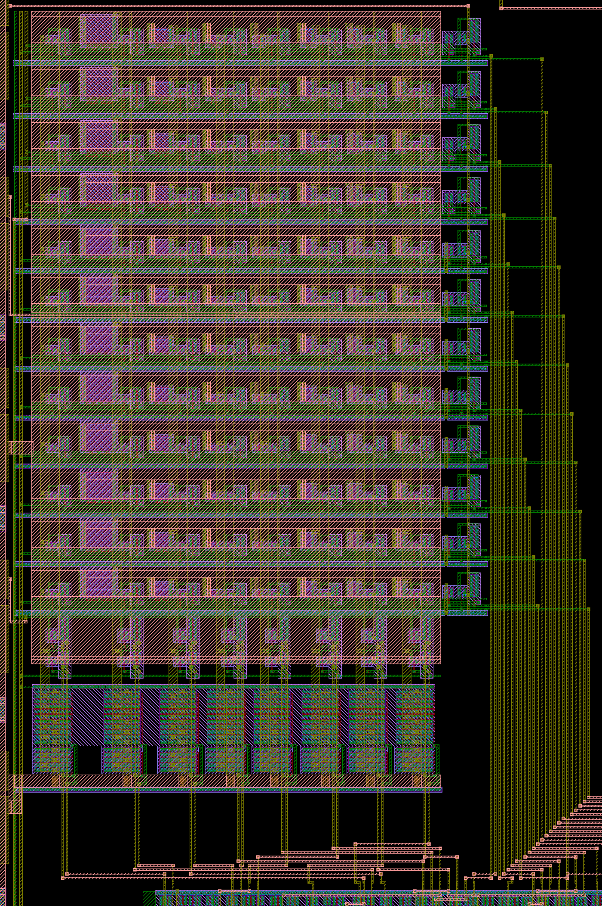
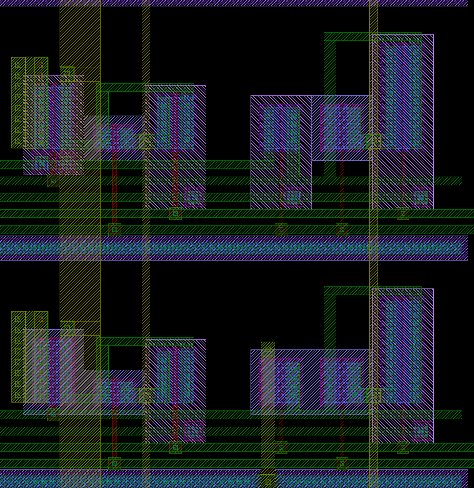

# Kelvin 소자 어레이 karray

계획서 "Kelvin 소자 어레이"의 12행 × 8열 어레이다. 생성기는 `designs/etri050/gen/etri050_array.py`이고, 직결 기준 소자(`../direct`)처럼 Python이 λ 격자(0.3 µm, 반 λ 허용)에서 좌표를 정하면 Magic이 킷 기술로 그린다. 회로도 넷리스트는 그린 도형이 아니라 회로 정의에서 따로 만들어 LVS로 맞춘다.

```bash
python3 designs/etri050/gen/etri050_array.py            # build/karray.{mag,gds}, sch/karray.spice, karray_pins.json
python3 designs/etri050/gen/etri050_array.py --check    # Magic DRC, ETRI GDS, 공식 규칙 KLayout DRC, LVS (etri-check)
python3 designs/etri050/array/kelvin_r.py               # Kelvin 루프 안 저항 추출 → build/kelvin_r.json, kelvin_r.csv
```

`kelvin_r.py`는 KLayout 0.30.2 이상의 Python 모듈(`klayout.pex`)과 numpy가 필요하다(Codespace에 있음, 없으면 `pip install klayout numpy`).

## 회로

| 부분 | 내용 | 계획서·모의와 다른 점 |
|---|---|---|
| 셀 (r, c) | DUT(행 0–7 NMOS, 8–11 PMOS) 게이트 G<r>, 소스 = 공통 소스 판 SRC(금속3), 드레인 = 열 force 선 D<c>(금속2). NMOS 바디 VSS, PMOS 바디 ANW(PMOS 행 N-well). 셀마다 드레인 sense TG N 3 / P 7.5 µm가 행 선택으로 DS<c>에 잇는다 | 없음(셀 sense는 `array_kelvin.py`가 정한 방식) |
| 열 기하 | 0: 9/0.6, 1: 9/1.2, 2: 9/3, 3: 3/0.6, 4: 3/3, 5: 9/9, 6: 18/18 µm, 7: open(DUT만 뺀 같은 셀, TG가 드레인 자리에서 D<7>을 받음) | 없음 |
| 행 구동 | 게이트 TG N 6 / P 15 µm(AG ↔ G<r>, row_sel/row_selb). 주차: NMOS 행은 NMOS W 6 µm로 G<r> → VSS(게이트 row_selb), PMOS 행은 PMOS W 6 µm로 G<r> → ANW(게이트 row_sel, 바디 VDD) | 주차 소자 W 3 → 6 µm(아래 안테나) |
| 열 스위치 | force TG N 4 × 25.2 / P 10 × 25.2 µm(100.8 / 252 µm, ADF ↔ D<c>), sense TG N 6 / P 15 µm(ADS ↔ DS<c>), 주차 TG N 3 / P 7.5 µm(D<c> → SRC, col_selb/col_sel) | force 100/250 → 100.8/252 µm(손가락 25.2 µm가 λ 격자). 주차를 NMOS 하나(모의)에서 TG로: 소스 판이 5 V 가까이 있는 PMOS 행에서도 선택 안 된 열의 VDS가 0이 되게 |

- Kelvin 점: 드레인은 접촉 줄의 위쪽 끝에서 force(비아1 → D<c>), 아래쪽 끝에서 sense(금속1 → 셀 TG)로 나눈다(L-split과 같은 방식). 소스 판은 왼쪽 가장자리에서 ASF가 force, 판 가운데에서 ASS가 sense한다(행 5와 6 사이 홈으로 들어가는 금속3 선).
- 포트 47개: AG, ADF, ADS, SRC, ANW, VDD, VSS, col_sel0–7, col_selb0–7, row_sel0–11, row_selb0–11. 칩 배선용 연결점(ASS, SRC_EDGE, ADS_M3, ANW_BOT, row_line<r>)은 `karray_pins.json`에만 있다(ASS는 SRC와 같은 넷이라 포트로 두면 LVS가 구분하지 못함).
- 열 순서: 물리적으로 왼쪽부터 7, 6, …, 0. 제어 블록 위 변 핀 순서(col_selb7–0, col_sel7–0)와 같은 방향이라 아래 배선 채널이 좁다.

## 레이아웃





- 크기 334 × 551 µm. 칩에서는 원점(행 0 아래, 맨 왼쪽 열 왼쪽)이 다이 (458, 950)이고 x 445–781, y 824–1376을 차지한다.
- 행 높이 NMOS 34.5 µm(115λ), PMOS 37.5 µm(125λ). 행마다 아래부터 VSS p+ 줄, SEL, SELB, VDD(TG 웰 탭), G, ANW(PMOS 행) 금속1 선이 지나고 그 위에 소자가 선다. 열 폭은 L ≤ 3 µm 33.6 µm, L 9 µm 39.6 µm, L 18 µm 48.6 µm.
- 행 0 아래 열 스위치 띠(124.8 µm): VSS p+ 줄, ADF 금속3 버스, force NMOS 4손가락, VDD 웰 안 force PMOS 10손가락, 주차 TG, sense TG(그 띠가 ADS 선).
- 소스: 셀마다 소스 접촉 줄 → 금속1 → 비아1 열 → 금속2 → 비아2 열 → 금속3 판. 비아 열 길이는 소자 폭과 13.5 µm 중 큰 값.
- 금속2·3은 폭·간격 1.2 µm 이상(규칙 1.0 µm), N-well 간격 4.2 µm(덱은 4.0 µm 미만을 표시). Magic이 쓰는 킷 GDS 스타일은 비아 패드 가장자리를 0.05 µm 당기므로, 비아 아래에는 평범한 금속을 깔고(접촉 줄 위 금속1 3λ 등) 비아 열 끝은 0.7 µm 이상 덮는다.

## 안테나

규칙 문서 v1.1은 금속 면적 / 게이트 면적 ≤ 400(8.MET1/10.MET2/12.MET3.ANT), 필드 poly / 게이트 ≤ 200(3.PL1.ANT)을 둔다. ETRI Calibre 덱은 poly 규칙만 켜 두었고(금속 규칙은 2023-11-23부터 주석), 킷 KLayout 덱에는 안테나 검사가 없다. `scripts/antenna_rules.py`가 문서 값으로 본다(게이트 종류별 비, 다이오드 인정 없음, 식각 단계별 연결과 완성 칩 연결 둘 다).

- PMOS 행의 row_sel에는 P 게이트가 주차 PMOS 하나뿐이고(NMOS 행의 row_selb에는 N 게이트가 주차 NMOS 하나뿐), 그 선은 칩에서 위쪽 행까지 가는 금속2 버스다. 계획대로 W 3 µm면 row_sel11의 금속2 755 µm²가 그 게이트의 419배로, 완성 칩 연결·게이트 종류별로 셀 때 400을 넘는다. W 6 µm로 키워 210배가 되었다. 주차 소자는 선택된 행에서 꺼져 있고 다른 행의 G만 붙잡으므로 측정 경로에는 변화가 없다(꺼진 누설은 AG가 공급).
- 칩 결과는 `../chip/README.md`의 검사 절.

## 검사 결과 (2026-11-01, Codespace, 킷 db09a3d)

| 항목 | 결과 |
|---|---|
| Magic DRC | 0 |
| 공식 규칙 KLayout DRC | 0 (규칙 115개 범주) |
| LVS | MATCH. 그린 소자 456개 = Netgen이 병렬 force 손가락 96개를 합쳐 양쪽 360개, W/L 속성 모두 일치 |
| 규칙 7–12, 문서 값(`scripts/metal_rules.py`) | 0 |
| 안테나(블록 단독) | 넘는 넷 0. 가장 큰 비: 금속1 110, 금속2 74 |

## Kelvin 루프 안에 남는 저항

네 단자 측정이라도 sense 점과 소자 사이 짧은 길은 측정에 들어간다.

- 소스: 소스 접촉 → 금속1 → 비아1·비아2 열 → 판 → ASS sense 점. 선택된 셀 전류 I에 대해 측정은 V(소스) − V(ASS) = I × (접촉 + 금속·비아)를 본다.
- 드레인: force 전류는 접촉 줄 위쪽 끝으로 들어오고 sense는 아래쪽 끝을 보므로, sense가 접촉 자리 줄 전위보다 조금 낮게 읽는다(음의 저항).

`kelvin_r.py`가 GDS에서 KLayout R 추출(`klayout.pex`)로 셀마다 뽑는다. 값은 규칙 문서 5.2·5.3의 typ(최대): 금속1·2 0.08(0.10), 금속3 0.05(0.06) Ω/sq, N+ 접촉 30(50), P+ 90(110), 비아1 2.0(3.0), 비아2 1.5(2.5) Ω/개. ASF 입구는 칩 조립의 금속3 9 µm 띠 자리(배열 좌표 y 117.6 µm)다. 셀 84개 전체는 [`kelvin_r.csv`](kelvin_r.csv)(Codespace 결과)에 있다. 금속·비아 부분(소스 + 드레인, Ω):

| 열 | W/L (µm) | NMOS typ | NMOS 최대 | PMOS typ | PMOS 최대 | 접촉(한쪽, 개수) N+ / P+ |
|---|---|---|---|---|---|---|
| 0 | 9/0.6 | 0.488–0.504 | 0.748–0.768 | 0.504–0.539 | 0.768–0.810 | 4.3 / 12.9 Ω (7) |
| 1 | 9/1.2 | 0.480–0.496 | 0.739–0.758 | 0.498–0.529 | 0.761–0.799 | 4.3 / 12.9 Ω (7) |
| 2 | 9/3 | 0.473–0.491 | 0.731–0.752 | 0.496–0.525 | 0.759–0.794 | 4.3 / 12.9 Ω (7) |
| 3 | 3/0.6 | 0.599–0.622 | 0.889–0.917 | 0.632–0.660 | 0.929–0.963 | 15.0 / 45.0 Ω (2) |
| 4 | 3/3 | 0.602–0.629 | 0.892–0.924 | 0.636–0.662 | 0.934–0.965 | 15.0 / 45.0 Ω (2) |
| 5 | 9/9 | 0.468–0.513 | 0.725–0.779 | 0.509–0.532 | 0.774–0.802 | 4.3 / 12.9 Ω (7) |
| 6 | 18/18 | 0.298–0.367 | 0.474–0.557 | 0.353–0.378 | 0.541–0.571 | 2.1 / 6.4 Ω (14) |

- 대부분은 소스 비아다: 비아1·비아2 열에 각 8개(W 18 µm는 11개)로 0.44 Ω(0.32 Ω). 나머지는 금속1·금속2와 판의 퍼짐 저항으로, 같은 열에서 행에 따라 최대 0.07 Ω 바뀐다. 드레인 줄 몫은 −0.014(W 3) · −0.061(W 9) · −0.12 Ω(W 18).
- 접촉은 소자 자체의 일부로 본다(L-split도 같은 접촉 줄). R_sd를 뽑을 때는 접촉이 R_sd에 들어간다.
- 계획 단계 모의(`array_path.py`, `array_kelvin.py`)는 소스 sense 탭에 전류가 흐르지 않아 소스 판이 이상적이었다. 레이아웃 뒤 모의(`../sim/blocks/array_post.py`, 아래)는 이 표의 값을 넣는다.

### 레이아웃 뒤 모의 (Codespace, ngspice-47, TT)

`array_path.py`의 8 × 8 NMOS 하네스에 셀 sense TG, D<c> 금속2 선 구간, 그린 스위치 크기(force 100.8/252, 행 주차 W 6, 열 주차 TG)와 위 표의 값을 넣었다. 측정 셀은 그 열 NMOS 행 중 금속·비아 저항이 가장 큰 셀이다. 기준 소자에도 같은 접촉을 넣어 경로 몫만 본다.

| 기하 | VDS 0.1 V R_tot 오차 typ / 최대 | VDS 4.5 V 전류 오차 typ / 최대 | typ 표를 빼고 공정이 최대일 때(VDS 0.1 / 4.5 V) | ΔVt 27 °C | ΔVt 125 °C(open 열 뺌) |
|---|---|---|---|---|---|
| 9/0.6 | +0.159 / +0.238 % | 0.092 / 0.136 % | 0.082 % / 0.045 % | ≤ 0.002 mV | ≤ 0.006 mV |
| 3/3 | +0.021 / +0.030 % | 0.017 / 0.025 % | 0.010 % / 0.008 % | ≤ 0.004 mV | ≤ 0.012 mV |
| 18/18 | +0.016 / +0.023 % | 0.019 / 0.027 % | 0.008 % / 0.008 % | ≤ 0.004 mV | ≤ 0.047 mV |

- 계획 하네스(이상적 판)에서는 문턱 이상 전류 오차가 0.033 % 이하였다. 그린 어레이에서는 W/L 9/0.6 셀(R_tot 약 308 Ω)에서 소스 비아 몫이 +0.16 %로 드러난다. 다른 셀은 0.03 % 이하다. 측정에서는 `kelvin_r.csv`의 typ 값을 빼면 공정이 최대 쪽에 있어도 약 0.08 %가 남고, L-split(셀 안 Kelvin)과 0·1열을 비교하면 실제 값을 칩에서 잴 수 있다(계획서의 비교).
- ΔVt는 계획 값(27 °C ≤ 0.012 mV, 125 °C open 뺀 뒤 ≤ 0.052 mV)과 같은 수준이다.
- `python3 run_all.py post`가 이 결과를 다시 확인한다(`build/kelvin_r.json`이 있을 때 기본 실행에 들어감).
