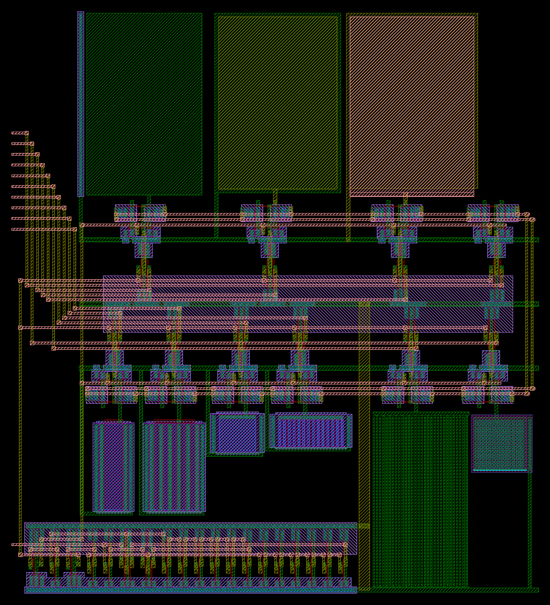
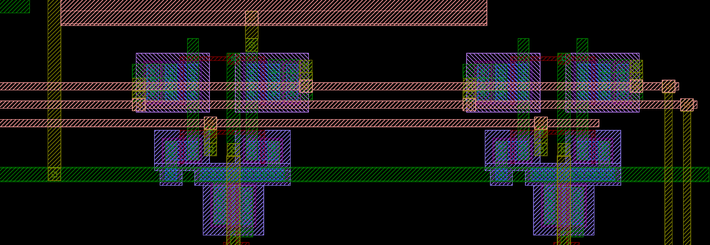

# CBCM 용량 측정 블록 cbcm

계획서 "3. CBCM 용량 측정"의 블록이다. 같은 비중첩 클록으로 구동하는 의사 인버터 두 개(DUT 노드 ND<i>, REF 노드 NR<i>)의 공급 전류 평균 차이로 C = (I(VCD) − I(VCR)) / (V·f)를 잰다. 생성기는 `designs/etri050/gen/etri050_cbcm.py`이고, Kelvin 어레이처럼 Python이 λ 격자(0.3 µm, 반 λ 허용)에서 좌표를 정하면 Magic이 킷 기술로 그린다. 표준셀은 킷 셀(INVX1, INVX4, NOR2X1, NAND2X1)을 그대로 놓는다. 회로도 넷리스트는 그린 도형이 아니라 회로 정의에서 따로 만들어 LVS로 맞춘다.

```bash
python3 designs/etri050/gen/etri050_cbcm.py            # build/cbcm.mag, cbcm_flat.gds, cbcm_full.gds(+ PIP), sch/cbcm.spice, cbcm_pins.json
python3 designs/etri050/gen/etri050_cbcm.py --check    # 평탄화한 Magic DRC, etri-check(LVS)
python3 designs/etri050/cbcm/cbcm_c.py                 # 규칙 문서 용량표로 셀마다 예상 용량 → build/cbcm_c.json, cbcm_c.csv
```

칩에 들어가는 것은 `cbcm_full.gds`다: Magic이 평탄화한 사본으로 쓴 GDS(`cbcm_flat.gds`)에 PIP를 KLayout으로 더한 것. 킷 Magic 기술에는 PIP 층(CAP)이 없어서, PDK pipcap 셀의 층 구성(NSD, CAP, POLY1, POLY2, LVSD, MET1 판, 접촉 23 × 23)을 문서 값으로 그려 넣는다.

## 회로

| 부분 | 내용 | 계획서와 다른 점 |
|---|---|---|
| 비중첩 클록 생성기 | clk → INVX1 → NOR2X1 두 개(SR 교차 결합), 각 되먹임에 INVX1 6단 지연. p2 → INVX1 → INVX4 = PCK(PMOS 쪽), p1 → INVX1 → INVX4 = NG(NMOS 쪽) | 지연 4단 → 6단. 4단은 FF 코너에서 PMOS 꺼짐 → NMOS 켜짐 간격이 0.12–0.14 ns였고 6단은 0.30 ns 이상(레이아웃 전, 같은 부하). 8단은 FF 5.5 V에서 위상을 잃음 |
| 셀 i (0–9) | PG<i> = NAND2X1(PCK, en<i>)가 의사 인버터 두 개의 PMOS 게이트, NG는 모든 셀의 NMOS 게이트. DUT: PMOS 6/0.6(VCD, N-well = VCD) + NMOS 3/0.6 → ND<i>. REF: 같은 쌍을 VCR에서 → NR<i> | 셀별 클록 게이트를 PMOS 쪽에만 둔다. 선택 안 된 셀은 PMOS가 꺼진 채(PG = VDD) NMOS만 NG로 켜져 노드가 0 V에 머물므로 VCD·VCR에서 전하를 받지 않는다(레이아웃 전 모의: 다른 구조가 모두 있을 때와 셀 2 혼자일 때 차이 0.002 %) |
| 구조 | 0 빈 셀, 1 PIP 30 × 30 µm, 2 MET1–필드 판, 3 MET2–MET1 판, 4 MET3–MET2 판, 5 MET1 빗살, 6 N+ 면적형, 7 N+ 둘레형, 8 게이트 W 48/L 10.5 µm, 9 게이트 5 × W 48/L 2.1 µm | 게이트 W 50/L 10, W 250/L 2 → W 48/L 10.5, 5 × W 48/L 2.1(λ 격자). 면적 504 µm²로 같고 소스·드레인 가장자리가 96 µm 대 480 µm(5배) |
| 포트 15개 | clk, en0–en9, VCD, VCR, VDD, VSS | 없음 |

## 레이아웃





그림은 `klayout -b -r scripts/render_gds.py -rd gds=designs/etri050/cbcm/build/cbcm_full.gds -rd png=<그림> -rd lyp=$ETRI050_LYP -rd width=1400`(확대는 `-rd box=180,185,296,225`)로 그린 것이다.

- 크기 295.8 × 324.9 µm(0.096 mm²), 칩에서 원점이 다이 (1144.0, 456.0)이다(제어 블록 오른쪽, x 1144.0–1439.8).
- 아래부터: y 0–36 µm 비중첩 생성기 한 줄(gnd 레일이 칩의 남쪽 VSS 선 위), 그 위와 오른쪽에 아래쪽 구조(셀 1, 5–9, y 101 µm까지), 아래 띠(셀 1, 5–9의 의사 인버터 쌍, 레일 쪽이 위로 뒤집힘), NAND2X1 두 줄(아래 줄 셀 1, 5–9, 위 줄 셀 0, 2–4, vdd 레일 공유), 위 띠(셀 0, 2–4의 쌍), 맨 위 금속 판 세 개(셀 2–4).
- 쌍은 REF 반쪽(왼쪽)과 DUT 반쪽(오른쪽)을 같은 모양으로 그린다. 노드 기둥(금속1)이 NR은 x 22–28 λ, ND는 54–60 λ에 있어 각각 NG·PG 금속1 옆을 지나는 것만 다르다(같은 층 이웃, 아래 예상 용량 절). 띠 레일(금속3)은 쌍 위를 가로지르는 NG, VCR, VCD 세 줄이다.
- en<i>는 제어 블록 오른쪽 변 핀과 같은 높이(블록 서쪽 변)로 들어와 금속2 꺾기와 금속3 트랙으로 자기 NAND의 B 입력에 간다. NG·PCK는 서쪽 기둥(금속2)으로 두 띠와 두 NAND 줄에 간다. VDD는 아래 변(S7 PVDD 쪽) 기둥으로, VCD·VCR은 동쪽 끝 기둥으로 두 띠의 레일을 잇는다.
- 금속2·3은 서로 다른 넷과 1.05 µm(3.5 λ) 이상 떨어지게 그린다(규칙 1.0 µm). 생성기의 `spacing_errors()`가 Magic에 넘기기 전에 이것을 본다.

구조:

| 셀 | 구조 | 그린 것 |
|---|---|---|
| 1 | PIP | POLY2 30 × 30 µm(900 µm², 둘레 120 µm)가 POLY1(VSS) 위. 윗판은 금속1 판과 접촉 23 × 23으로 ND1, 아랫판은 오른쪽 접촉 줄로 VSS |
| 2 | MET1–필드 | 금속1 판 64.8 × 102.0 µm, 왼쪽에 p+ 탭 띠 |
| 3 | MET2–MET1 | 금속2 판 66.6 × 96.6 µm, 아래에 사방 2.1 µm 큰 금속1 VSS 판 |
| 4 | MET3–MET2 | 금속3 판 69.6 × 100.8 µm, 아래에 금속2 VSS 판(판 아래 끝 4.5 µm는 필드 위) |
| 5 | MET1 빗살 | 손가락 폭·간격 0.9 µm, 길이 95.4 µm, VSS·ND5 각 15개(마주 보는 길이 2772 µm) |
| 6 | N+ 면적형 | n+ 20.1 × 20.1 µm(404.0 µm², 둘레 80.4 µm), 위 끝 접촉 줄, 양옆 p+ 탭 |
| 7 | N+ 둘레형 | n+ 손가락 0.9 × 15 µm 14개(간격 1.8 µm) + 접촉 줄(253.8 µm², 둘레 495.6 µm) |
| 8 | 게이트 L 10.5 | NMOS W 48/L 10.5 µm 하나, 게이트 = ND8, 소스·드레인·바디 = VSS |
| 9 | 게이트 L 2.1 | NMOS W 48/L 2.1 µm 다섯 손가락(소스·드레인 공유) |

## 검사 결과

| 항목 | 결과 |
|---|---|
| Magic DRC(평탄화한 사본) | 0. 계층 그대로 보면 14개로, 킷 셀의 레일이 서로 맞닿은 "can't abut" 표시다(킷 `drc_core.sh`도 무시, 제어 블록 `teg_ctrl_F`처럼 평탄화하면 없어짐) |
| LVS(etri-check, Netgen) | MATCH |
| 공식 규칙 KLayout DRC, `cbcm_full.gds` | 0 (Codespace, 킷 db09a3d). 계층 GDS(`cbcm.gds`, PIP 없음)로 보면 7.CONT.S1 10개: 쌍의 p+ 탭과 표준셀 레일 탭의 접촉이 각자 만들어져 겹친 자리(y 124 µm 레일)라, 칩에는 평탄화한 사본을 쓴다 |
| 규칙 7–12, 문서 값(`scripts/metal_rules.py`) | 0 |
| 안테나(블록 단독) | 넘는 넷 0. 가장 큰 비: poly 14, 금속1 29, 금속2 43, 금속3 94 |
| PIP 연결 | POLY2 = ND1, POLY1 = VSS(접촉이 POLY2 위면 POLY2에만 닿는 것으로 따로 뽑아 확인) |

## 예상 용량

### 규칙 문서 용량표로 (`cbcm_c.py`)

ND<i>와 NR<i>를 `cbcm_full.gds`에서 KLayout 연결로 뽑고(넷 이름은 생성기가 그린 금속 사각형으로 찍어서, 단락·끊김이 있으면 멈춤), 이웃 넷마다 규칙 문서 v1.1 5.5(층 쌍의 면적 fF/µm²·가장자리 fF/µm, typ)와 5.4(POLY2–POLY1 0.50 fF/µm²)로 더한다. 도형 위아래로 가장 가까운 도체를 찾아 면적을 나누고, 가장자리는 바깥 5 nm 띠 아래에 무엇이 있는지로 나눈다. 같은 층 이웃 사이 용량은 문서에 없어 마주 보는 길이만 적는다(빗살이 그 값을 잰다). 결과는 `cbcm_c.csv`.

| 셀 | 구조 | 구조 fF | 리드 fF | 쌍 차이 fF | ND − NR fF |
|---|---|---|---|---|---|
| 0 | 빈 셀 | 0 | 0.10 | 0.000 | 0.00 |
| 1 | PIP | 461.10 | 0.74 | 0.000 | 461.73 |
| 2 | MET1–필드 | 305.97 | 0.40 | 0.000 | 306.27 |
| 3 | MET2–MET1 | 303.41 | 0.28 | 0.304 | 303.89 |
| 4 | MET3–MET2 | 301.25 | 2.52 | 0.304 | 303.97 |
| 5 | MET1 빗살 | 221.12 | 3.33 | 0.000 | 224.35 + 옆면 |
| 6 | N+ 면적형 | 305.11 | 0.76 | 0.000 | 305.77(0 V) |
| 7 | N+ 둘레형 | 337.26 | 0.82 | 0.000 | 337.98(0 V) |
| 8 | 게이트 L 10.5 | 1533.52 | 1.22 | 0.000 | 1534.64 |
| 9 | 게이트 L 2.1 × 5 | 1657.78 | 1.22 | 0.000 | 1658.90 |

- "쌍 차이"는 띠 안 ND와 NR의 차이로, 셀 3·4는 띠 안에서 시작하는 리드(비아1·금속2)다. 쌍 자체는 모든 셀에서 같아 ND와 NR이 전환하는 넷(NG, PG<i>)에 붙는 용량도 2.71 fF로 같다.
- 이 표를 만들며 쌍 하나가 달랐던 것을 고쳤다: NG 띠 레일이 동쪽 끝 쌍(셀 0, 1)의 NG 비아에서 끝나 그 두 셀의 ND만 NG 레일 아래를 지나지 않았다(0.18 fF). 빈 셀 0이 모든 셀의 기준이므로 레일을 마지막 쌍의 ND 기둥 너머까지 늘였다.
- 접합(셀 6, 7)의 문서 값은 0 V 값이다(N+ 0.6882 fF/µm²·0.3212 fF/µm, nmos4 모델의 CJ·CJSW와 거의 같음). 측정은 0 V에서 VCD까지 충전한 Q(V)/V를 보므로 아래 PDK 모델 값과 비교한다.

### 레이아웃 뒤 모의 (`sim/blocks/cbcm_post.py`)

블록 넷리스트(LVS와 같은 회로)에 `cbcm_c.py`의 배선 용량(금속·필드 poly; 접합·게이트 용량은 소자 모델이 가짐)을 더하고, 구조는 그린 기하로 PDK 모델을 쓴다: PIP pipcap_i(COX × 면적 + CAPSW × 둘레), N+ ndiode(면적, 게이트를 향하지 않은 둘레), 게이트 nmos4. 금속 구조는 배선 용량에 들어 있다. TT 27 °C, VDD = VCD = VCR = 5 V, 1 MHz.

| 셀 | 구조 | 모델 fF | 리드 fF | 기대 fF | CBCM 모의 fF | 차이 |
|---|---|---|---|---|---|---|
| 0 | 빈 셀 | – | 0 | 0 | −0.00 | – |
| 1 | PIP | 460.82 | 0.93 | 461.75 | 466.51 | +4.76 fF(+1.03 %) |
| 2 | MET1–필드 | (배선) | 306.27 | 306.27 | 310.77 | +4.50 fF(+1.47 %) |
| 3 | MET2–MET1 | (배선) | 303.89 | 303.89 | 308.41 | +4.52 fF(+1.49 %) |
| 4 | MET3–MET2 | (배선) | 303.97 | 303.97 | 308.50 | +4.53 fF(+1.49 %) |
| 5 | MET1 빗살 | (배선) | 224.35 | 224.35 | 228.57 | +4.22 fF(+1.88 %), 옆면 용량 제외 |
| 6 | N+ 면적형 | 197.13 | 1.90 | 199.03 | 200.74 | +1.71 fF(+0.86 %) |
| 7 | N+ 둘레형 | 214.36 | 4.12 | 218.48 | 219.52 | +1.04 fF(+0.48 %) |
| 8 | 게이트 L 10.5 | 1525.56 | 5.70 | 1531.26 | 1534.64 | +3.38 fF(+0.22 %) |
| 9 | 게이트 L 2.1 × 5 | 1653.52 | 9.62 | 1663.14 | 1666.32 | +3.18 fF(+0.19 %) |

- "리드"는 ND<i> − NR<i>의 배선 용량이다. 게이트 셀은 게이트 끝·막대의 필드 poly가 여기에 든다.
- CBCM이 기대보다 큰 몫(선형 용량에서 약 +4.5 fF, 접합 +1–1.7 fF, 게이트 +3.2–3.4 fF)은 의사 인버터의 전하 주입·짧은 관통 전류에서 오는 계통 오차로, 레이아웃 전 모의(`cbcm_block.py`)와 같다. 측정값에서 이 모의 값을 빼고(계획서 설계 규칙), 빈 셀 0으로 실리콘의 DUT·REF 불일치를 뺀다.
- 비중첩 간격(셀 2 게이트, NG가 VTN, PG가 VCD − VTP를 지나는 때): 레이아웃 뒤 최소 0.47 ns(FF, VDD 4.5 V; 레이아웃 전 0.30 ns). 배선 부하(PCK 144 fF, NG 130 fF, 지연 단마다 13–16 fF)가 늦춘 만큼 간격이 넓어졌다.
- 셀 2의 차이는 5코너 27 °C, TT·SS·FF 125 °C, VDD 4.5·5.5 V, 클록 0.2·5 MHz에서 +1.34–1.68 %다. C–V(셀 6–9, 1.5–5 V)는 기대보다 0.19–0.96 % 크다(낮은 전압일수록 큼).
- 그 밖: 클록을 멈추고 셀을 고르지 않으면 VCD·VCR 전류 0.05 pA. 공급에 PADR 725 Ω을 넣으면 셀 2가 +0.25 %p, 셀 8이 +0.02 %p 변한다.

### N+ 접합: PDK의 두 기술

PDK는 n+ 접합을 두 번 기술한다. 다이오드 소자 ndiode(CJ 7.12 × 10⁻⁴ F/m², CJSW 2.58 × 10⁻¹⁰ F/m)와 nmos4의 소스·드레인(CJ 6.83 × 10⁻⁴, CJSW 3.29 × 10⁻¹⁰)이다. 측벽 값이 27 % 달라 둘레가 큰 셀 7에서 갈린다(5 V Q(V)/V, 리드 제외):

| 셀 | ndiode | nmos4 소스·드레인 | 규칙 문서(0 V) |
|---|---|---|---|
| 6 N+ 면적형 | 197.1 fF | 192.7 fF | 303.9 fF |
| 7 N+ 둘레형 | 214.4 fF | 236.9 fF | 333.9 fF |

셀 6과 7은 면적과 둘레의 비가 달라, 두 셀의 C–V(VCD 1.5–5 V)로 면적·측벽 성분과 그 전압 의존(MJ·MJSW)을 나눠 볼 수 있다.

## 측정

1. VDD 5 V, VCD = VCR = V(1.5–5 V), CCK(S6)에 0.2–5 MHz 클록. 스캔으로 mode = 10(CBCM), cbsel = i를 넣으면 제어 블록이 `cbcm_clk = cck · mode10`과 `cbcm_en[i]`를 낸다.
2. VCD·VCR 공급의 평균 전류를 재고 C_i = (I_VCD − I_VCR) / (V·f). 셀 0(빈 셀)으로 같은 측정을 해 쌍 불일치 C_0를 얻고 C_i − C_0를 쓴다. 위 표의 모의 계통 오차를 뺀다.
3. 게이트·N+ 셀은 V를 바꿔 C–V를 얻는다(1.5 V 아래는 PMOS가 충분히 켜지지 않음, 계획서). 1 MHz에서 300 fF × 5 V = 1.5 µA 차이다.

## 칩 연결 (`../chip/assemble.py`)

| 넷 | 연결 |
|---|---|
| clk, en0–en9 | 제어 블록 오른쪽 변 핀(금속3, x 1136.7–1137.9)에서 블록 서쪽 변 핀(금속3, x 1144.0–1145.2)까지 곧게. 두 핀은 높이가 0.02 µm 다르다. en3·en4는 제어 블록 안 cbcm_en[2] 배선이 핀 바깥(x 1139.7–1140.9)으로 꺾어 올라가므로 금속2로 건넌다(핀마다 비아2) |
| VDD | S7 PVDD 포트에서 금속2(6 µm)로 남쪽 VSS 선을 건너 블록 VDD 기둥 아래 끝. S7은 패드 링 전원 레일로 W1과 같은 넷이다 |
| VSS | 생성기 줄 gnd 레일이 남쪽 VSS 선(금속1) 위에 놓이고, NAND 두 줄의 gnd 레일 동쪽 끝을 금속1로 동쪽 VSS 선(x 1447–1456)에 잇는다 |
| VCD | 아래 띠 VCD 레일(금속3)을 VCR 기둥 위로 블록 밖까지 늘이고, 블록과 동쪽 VSS 선 사이(x 1442–1444)에서 금속2로 내려가 y 519–521로 E1 PADR. E1의 PAD 포트(y 538.8–586.0)와는 세로 금속2가 x로 14 µm 떨어진다 |
| VCR | VCR 기둥의 포트 높이(y 649.4–651.4)에서 금속2로 동쪽 E2 PADR까지 곧게 |

VCD·VCR은 µA 평균이라 PADR 포트(직렬 저항)를 쓴다(PADR 영향은 위 모의).
