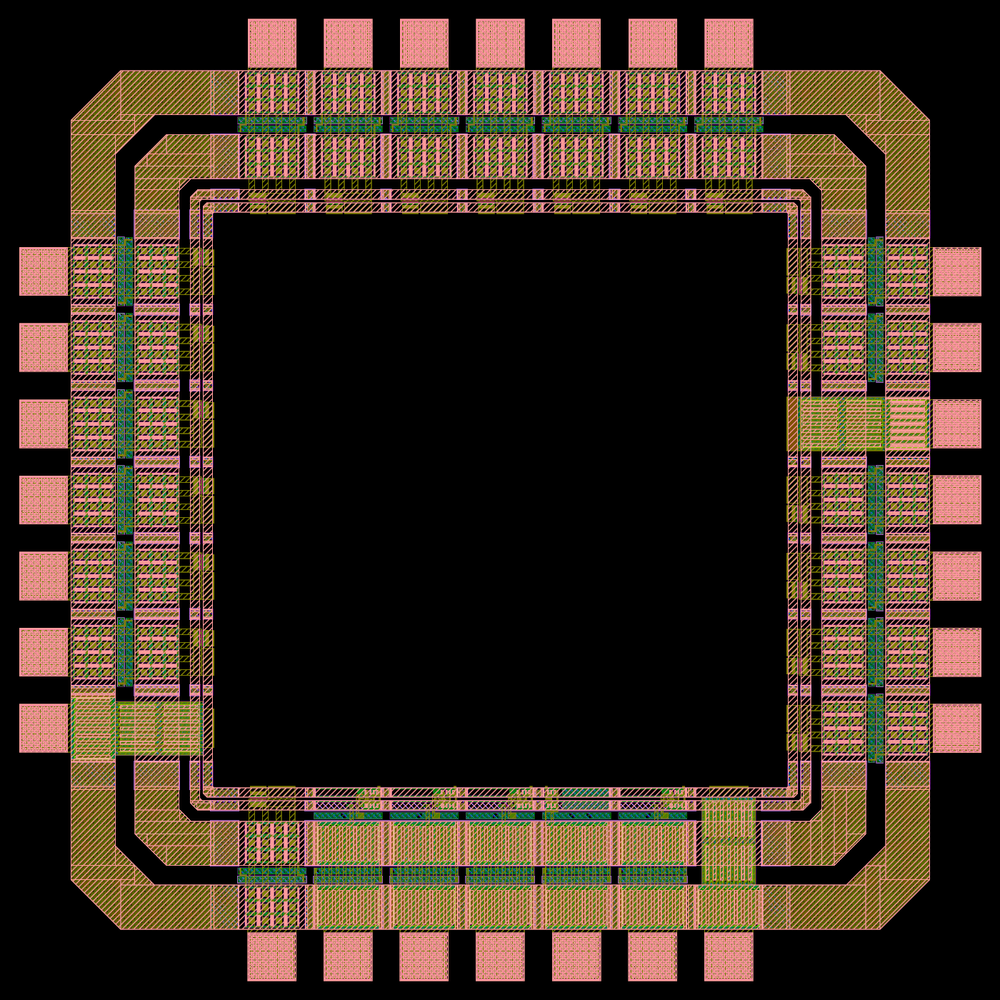
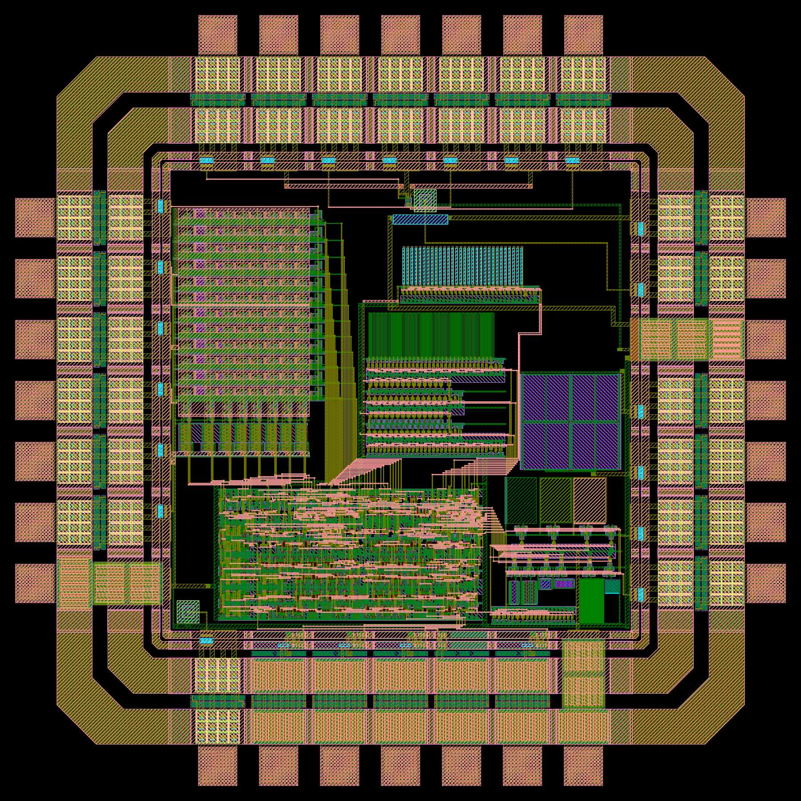
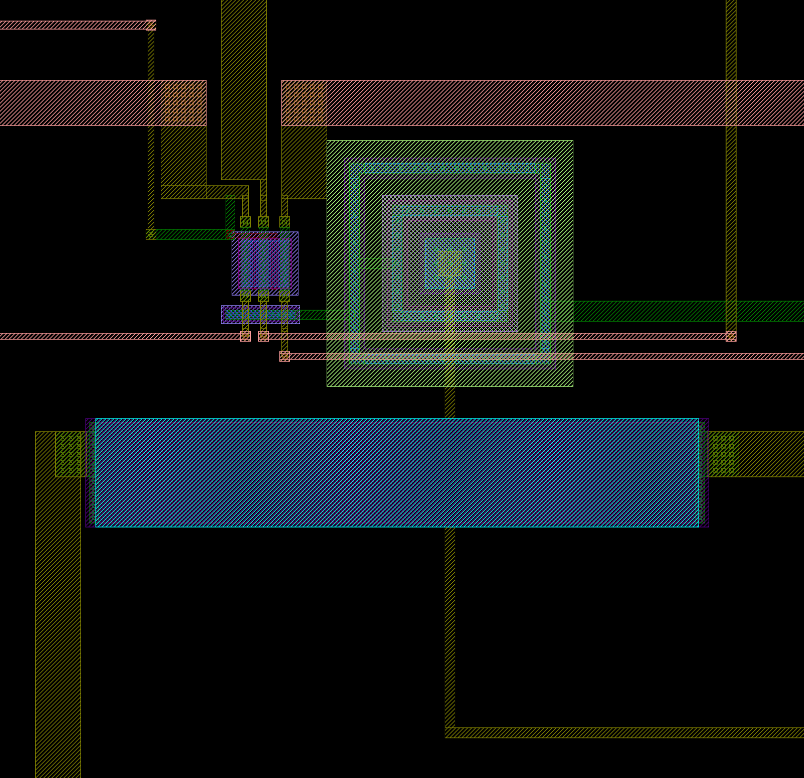

# 칩 조립 pdkv

PDK 모델 검증용 온칩 특성화 IC의 최상위 조립이다. 킷의 칩 조립 방식(FIR_PE MPW240925002, pong_pt1 MPW2025 STD-II)처럼 패드 링(`pdkv_Pad`)과 코어를 따로 만들어 최상위 `pdkv_Top`으로 합친다. 지금 칩은 패드 링 + 제어 블록 + 직결 기준 소자(L-split, MOS-C, PNP 2개, 히터) + Kelvin 소자 어레이 + CBCM 블록 + RO 뱅크(INV·NAND·NOR·배선) + 저항 RO로 된 제출 가능판이다.

```
pins.csv          28개 패드: 패드 위치(W1–W7 아래→위, N1–N7 왼→오, E1–E7 아래→위, S1–S7 왼→오), 핀, 셀, 포트, 기능, 범위
pad_ring.py       킷 28핀 GPIO 템플릿 → build/pdkv_Pad.mag, build/pad_pins.json(코어 쪽 포트 위치)
run_pad_ring.sh   패드 링 생성 → Magic GDS(lambda=0.30(ETRI-G)) → pad_gds.py → 공식 규칙 KLayout DRC, 킷 템플릿 링과 비교
pad_gds.py        Magic이 쓴 링의 배치는 그대로 두고 셀 내용을 ETRI GPIO 라이브러리 GDS(ETRI_NSPL_GPIO_250610)로 바꿈
assemble.py       블록 배치 + 배선(실링·칩 경계는 -rd seal=1일 때만) → build/pdkv_Top.gds, build/pdkv_nets.json(검사할 넷과 블록 위치)
chip_check.py     금속 연결 검사(끊김, 단락, 떠 있는 금속, 별 접지·Kelvin 쌍)와 0.01 µm 격자 검사
chip_lvs.py       패드 링 안 전체의 소자 수준 LVS(KLayout, ETRI Calibre LVS 덱의 소자 인식) → build/chip_lvs.log,
                  build/pdkv_core_lvs.lvsdb(KLayout 넷리스트 브라우저), --spice로 그린 그대로의 넷리스트
chip_lvs_selftest.py  레이아웃·기준에 오류 31가지를 하나씩 넣어 chip_lvs.py가 모두 불일치로 잡는지 확인(약 3분)
device_map.py     chip_lvs.py가 뽑은 소자(그린 그대로)를 블록 > 종류·크기 > 소자로 묶은 마커 DB → build/pdkv_devices.lyrdb
                  (KLayout Marker Browser, 아래 "KLayout에서 소자 보기")
run_chip.sh       입력이 없으면 만들고(패드 링, 직결 소자, PDK 셀, 어레이, CBCM, RO 뱅크·저항 RO) 조립 → 공식 규칙 덱 → 문서 기준 금속 규칙
                  → 연결 검사 → 안테나(scripts/antenna_rules.py) → 소자 수준 LVS(chip_lvs.py) → … → 제출 GDS 검사(gds_check.py)가
                  통과하면 제출 파일 build/pdkv_Top.zip
checks_selftest.py  ERC·제출 GDS·전류 밀도·Calibre 덱 검사·규칙 7–12에 오류 18가지를 넣어 모두 잡는지 확인(약 8분)
calibre/          실제 Calibre로 돌릴 묶음: make_run.py(ETRI 덱·설정, pong 확인, 칩 DRC·안테나, lvs_inputs.py의 코어 LVS 입력)
                  → build/pdkv_calibre.tar.gz, compare.py가 결과를 예측과 맞춤(calibre/README.md)
```

## 패드 링



- 킷 템플릿 `pads_ETRI/MPW_PAD_28Pin_IO.mag`는 PIC 28개(PAD_0–PAD_27), 모서리 4개, 필러 32개를 1.9 × 1.9 mm 프레임에 135 µm 간격으로 놓는다. `pad_ring.py`는 템플릿 배치를 그대로 두고 셀만 바꾼다(PANA 20, PIC 4, POB4 1, PVDD 2, PVSS 1). 킷의 FIR_PE·pong_pt1도 같은 템플릿에서 셀을 바꿔 만들었다.
- 템플릿 순서는 쓰기 전에 변환 행렬로 확인한다: S1–S7 = PAD_0–PAD_6, E1–E7 = PAD_7–PAD_13, N1–N7 = PAD_20–PAD_14, W1–W7 = PAD_27–PAD_21. 패드 중심은 S변 545, 680, …, 1355 µm다.
- 코어 쪽 포트는 GPIO 셀 안쪽 끝(다이 좌표 442 µm와 1458 µm)의 금속2다. 코어 창은 1016 × 1016 µm다. 포트 위치는 `build/pad_pins.json`에 남긴다(PANA는 PAD 47.2 µm·PADR 27.2 µm 폭, PIC Y·POB4 A는 3.2 µm 폭).
- force·히터 6핀(ADF, ASF, LD1F, LSF, LD2F, HT)은 PANA의 무저항 포트 PAD에 잇는다. GPIO 문서는 PAD 포트를 "사전 협의 혹은 설계자의 내부 회로 ESD 검토"로 두고, ETRI 답(문의 1번, 2026-11-06)은 회로 설계 방법은 답하기 어렵고 GPIO를 쓰지 않는 MPW 칩도 있으니 설계자가 ESD 검토가 필요 없다고 판단하면 쓰지 않아도 된다는 것이다. 설계자 검토: 이 6넷에는 게이트가 없고(ERC의 패드 넷 게이트 목록, 아래 검사 7번) 소스·드레인 확산과 히터 poly2에만 닿는다. PANA의 다이오드는 본딩 패드 쪽에 있어 PAD 포트에도 그대로 걸린다. 게이트가 붙는 아날로그 핀(LG, AG, CHI)은 모두 PADR이다. 그래서 PAD로 둔다. 다루고 잴 때는 정전기 방지 절차(손목띠, 소켓에 넣고 뺄 때 계측기 출력 끔)를 지킨다. 직렬 저항 포트로 바꾸는 `--force-port PADR`은 쓰지 않는다.
- GPIO 셀은 ETRI 라이브러리 GDS 그대로 쓴다(`pad_gds.py`, 2026-11-02). 킷의 Magic 셀(`pads_ETRI/GDS_Magic`)은 ETRI GDS를 Magic으로 다시 그린 사본이라, 그것으로 쓴 링은 ETRI 셀과 다르다:
  - PANA의 P+/N-well ESD 다이오드(`pdiode10`, 셀마다 12개)에 N-well이 없다. Magic 셀에 nwell 칠이 없어 ETRI-G 양식이 NWELL을 쓰지 않는다(ETRI 원본과 킷의 `GDS_Magic/pdiode10.gds`에는 있음). 그러면 패드에 붙은 p+ 양극이 기판 접촉이 되어 PANA 패드 20개가 모두 기판(VSS)에 붙는다. ETRI GPIO 문서(02_ETRI_5V_GPIO_260615)는 PANA를 N·P 다이오드 셀로 적는다.
  - 모든 셀의 NSD·PSD를 Magic이 확산 종류에서 다시 그려 범위가 다르고, RES·LVSD·DIODE·ESDD 층이 없다.
  - `pad_gds.py`는 Magic이 정한 배치(셀 64개와 변환 행렬)를 그대로 두고 라이브러리에 있는 셀(PANA, PIC, POB4, PVDD, PVSS, PCORNER, IOFILLER50)을 라이브러리 셀로 바꾼다. 라이브러리에 없는 킷 셀 IOFILLER18(필러 24개, 소자 없음)은 Magic 그대로 한 셀로 평탄화한다. 배치와 변환이 같은지, 바꾼 셀이 라이브러리 셀과 층마다 같은지 확인한다. ETRI GDS가 1 × 1 배열(AREF)로 놓은 하위 셀 18곳은 한 번 놓기(SREF)로 쓴다: KLayout이 그대로 쓰면 피치가 0인 배열이 되어 읽기를 거부하는 도구가 있다(도형·라벨은 그대로). `build/pdkv_Pad.mag`는 배치 원본일 뿐이고 셀 내용은 결함이 있는 Magic 사본 그대로다.
  - 버전은 ETRI PDK 260820에 든 ETRI_NSPL_GPIO_250610이다. 킷의 Magic 셀이 따른 231208과는 셀마다 비아1·비아2(약 330·290 µm²)와 PIC의 작은 소자 층이 다르고, 두 버전 모두 공식 덱 0이며 문서 규칙 표시(11.VIA2.S1 16개)도 같다(그 뒤 넓은 금속 간격 검사의 shielding을 끄자 250610판 링에서 10.MET2.S2 10개가 더 나왔다. 아래 검사 2번).
  - 확인: 링만 뽑아 보면 Magic 링은 PANA 본딩 패드 20개가 모두 기판의 p+(패드마다 다이오드 양극 12개, 1200 µm²)에 닿는다. PAD 포트 6개(ADF, ASF, LD1F, LSF, LD2F, HT)는 본딩 패드와 같은 금속 넷이고, PADR 포트 14개는 직렬 poly2 저항 너머다. ETRI 셀 링은 0이다(양극 240개 모두 N-well 안, 둘레 8.5 µm 이상). 칩에서 기판 탭에 닿는 넷은 VSS(그리고 POB4 안 가드링 하나, `PDKV_SEAL=1`이면 실링)뿐이고, N-well은 VDD·ANW·VCD·VCR·CLO와 PNP 베이스(VSS)에만 붙는다. 칩 GDS의 차이는 모두 패드 셀 자리 안에 있다.

### 결과 (2026-11-02, 작업 환경 KLayout 0.28.16, 킷 111dc09)

| 항목 | pdkv_Pad | 킷 템플릿 링(PIC 28개) |
|---|---|---|
| 셀 | 64개(PANA 20, PIC 4, POB4 1, PVDD 2, PVSS 1, 모서리 4, 필러 32), 못 찾은 셀 0 | 64개 |
| 크기 | 1705 × 1705 µm(97.5–1802.5 µm) | 같음 |
| 공식 규칙 KLayout DRC | 0 | 0 |

- Magic 셀로 쓴 링은 5.NSD.S1이 14개(템플릿 링 84개, PIC마다 3개) 나왔다. Magic이 다시 그린 주입 층에서 나온 표시로, ETRI 셀로 바꾸면 모두 없어진다. 우리 링의 14개는 PIC 4개 × 3 + POB4 1개 × 2이고, 같은 킷 흐름으로 만든 FIR_PE 링(PIC 16, POB8 9)의 ETRI Calibre 결과 5.NSD.S1 66개도 16 × 3 + 9 × 2와 맞는다.

## 칩 조립

```bash
bash designs/etri050/chip/run_chip.sh             # 결과 요약: build/chip_summary.txt
bash designs/etri050/chip/run_chip.sh --rebuild   # 패드 링·직결 소자·PDK 셀도 다시 만듦
```

킷 `generate_chip.sh` ④단계(각 GDS를 읽어 놓고 최상위로 씀)를 KLayout으로 한다. 패드 링은 자기 좌표(다이 좌표, 97.5–1802.5 µm) 그대로 두고, 나머지 블록은 GDS 셀째로 다이 좌표에 놓은 뒤 배선을 그린다. 모든 입력이 ETRI 층 번호의 GDS다.

| 블록 | GDS | 위치(다이 좌표 µm) | 연결 |
|---|---|---|---|
| 제어 블록 `teg_ctrl_F` | `ctrl/macro/teg_ctrl.gds.gz`(고정 매크로, 아래) | x 537.0–1140.9, y 460.0–761.1 | 스캔 5핀 → S2–S6, vdd 막대 ← W1 PVDD, gnd 막대 ← VSS, 위 변 선택 핀 40개 → 어레이, `ro_en`·`ro_in` 0·1·2·4 ↔ RO 뱅크, 5 ↔ 저항 RO, `ro_in3` → gnd(만들지 않은 FO4), `ro_en3`은 열어 둠(출력) |
| Kelvin 어레이 `karray` | `array/build/karray.gds`(`gen/etri050_array.py`, `../array/README.md`) | 원점 (458.0, 950.0), x 445–781, y 824–1376 | 선택선 40개 ← 제어 블록(채널·버스, 아래), ANW·ADF·ADS·ASF·ASS·AG ← 서쪽 패드 W2–W7, VDD 띠 → W1 VDD 선, VSS 띠 → 남쪽 VSS 선 |
| CBCM `cbcm` | `cbcm/build/cbcm_full.gds`(`gen/etri050_cbcm.py`, `../cbcm/README.md`) | 원점 (1144.0, 456.0), x 1144.0–1439.8, y 454.2–780.6 | clk·en0–9 ← 제어 블록 오른쪽 변 핀, VCD → E1, VCR → E2(PADR), VDD ← S7 PVDD, VSS → 남쪽·동쪽 VSS 선 |
| RO 뱅크 `robank` | `ro/build/robank_flat.gds`(`gen/etri050_ro.py`, Magic 평탄화 사본, `../ro/README.md`) | 원점 (856.0, 826.0), x 857.2–1208.9, y 823.0–1144.0 | ro_en·ro_in 0·1·2·4 ↔ 제어 블록 위 변 핀, VDD ← 제어 블록 vdd 막대, VSS ← 제어 블록 gnd 막대 |
| 저항 RO `rores` | `ro/build/rores_full.gds`(`gen/etri050_ro.py`, Magic 평탄화 사본 + KLayout으로 넣은 poly2 저항 30개, `../ro/README.md`) | 원점 (932.0, 1166.0), x 933.2–1262.1, y 1161.8–1291.15 | ro_en5·ro_in5 ↔ 제어 블록 위 변 핀(RO 뱅크와 MOS-C 사이 틈으로), VDD·VSS ← RO 뱅크 서쪽 기둥 |
| L-split | `direct/build/lsplit.gds` | 활성 영역 왼쪽 아래 (962.9, 1388.0) | force LD1F·LSF·LD2F → N2·N4·N6(PAD), sense → N3·N5·N7(PADR), LG → N1, 기판 탭 → VSS |
| MOS-C(위아래 뒤집음) | `direct/build/mosc.gds` | x 1214.8–1438.0, y 792.6–1013.7 | 게이트 막대(아래) → CHI(E3), N-well·p+ 막대(위) → CLO(E4) |
| PNP1 | `direct/build/pnp10.gds` | x 980.0–1029.0, y 1368.0–1417.0(L-split 바로 옆) | E → PE1(E6), B·C → VSS 가지, L-split 기판 탭과 짧은 금속1로 이어짐 |
| 히터(180° 회전) | `direct/build/heater.gds` | x 932.0–1056.0, y 1340.0–1361.6(L-split·PNP1 아래) | A(동쪽 머리) → HT(E7 PAD), B(서쪽 머리) → PVSS 전용 귀환선 |
| PNP2 | 같음 | x 455.0–504.0, y 458.0–507.0(남서 모서리) | E → PE2(S1), B·C → 남쪽 VSS 선 |





그림은 `klayout -b -r scripts/render_gds.py -rd gds=designs/etri050/chip/build/pdkv_Top.gds -rd png=<그림> -rd lyp=$ETRI050_LYP -rd width=1800`로 그린 것이다(확대 그림은 `-rd width=1600 -rd box=915,1290,1075,1445`). 어레이 그림(`../array/README.md`)은 `-rd width=1400 -rd box=436,744,862,1384`, 셀 확대는 `-rd width=1400 -rd box=712,1191.5,782,1263.5 -rd hide=36`(금속3 소스 판을 숨김)이다.

열 묶음: 계획서의 M6(히터 + PNP + 기준 소자: 열저항, 자기 발열 보정)와 PE1 "기준 소자 옆"을 따른다. PNP1은 L-split 바로 옆에 두어 L-split 채널 중심과 PNP1 이미터 중심이 37 µm 떨어진다. 히터는 둘 아래에 가로로 두고, 히터 긴 변에서 L-split 채널과 PNP1 이미터까지가 똑같이 32 µm이고 두 소자 모두 히터 길이(124 µm)의 가운데 쪽에 있어, 히터 전력이 두 소자를 거의 같은 만큼 데운다(히터로 PNP1과 L-split의 열 결합을 맞춰 봄). L-split 고전류 바이어스(5 V × 4.6 mA ≈ 23 mW)가 PNP1 자리에 만드는 온도 상승은 점열원 근사 P/(2πκr)(κ = 150 W/m·K, r = 37 µm)로 약 0.7 K, V_EB로 약 1.4 mV(−2.1 mV/K)라 잴 수 있다. PNP2는 히터에서 약 1 mm 떨어진 남서 모서리에 있다.

RO 뱅크는 어레이 행 버스 오른쪽, 제어 블록 위에 넣었다: 제어 블록 위 변의 ro_en·ro_in 핀과 vdd·gnd 막대에 가깝고, 위 끝(배선 RO 사행선, y 1144.0)은 히터 귀환선(y 1150) 아래다. CBCM은 제어 블록 오른쪽에 두어 제어 블록의 CBCM 핀(오른쪽 변)과 E1·E2(VCD, VCR), S7 PVDD에 가깝다.

저항 RO는 RO 뱅크 자리에 들어가지 않아, 칩 GDS의 모든 층을 2 µm 격자로 찍어 찾은 빈 띠(히터 귀환선 위 x 932–1405, y 1160–1297: 아래 귀환선 금속2, 위 PE1 금속2 y 1298, 서쪽 귀환선 세로 x 922–931, 동쪽 PE1 세로 x 1406)의 서쪽에 넣었다(x 933.2–1262.1, y 1161.8–1291.15; PE1까지 6.85 µm). 열 묶음과는 히터 아래 변(y 1340)까지 48.85 µm 떨어지고, RO는 열 측정과 따로 켠다. 남은 빈 자리: 같은 띠 동쪽 x 1264–1405, MOS-C 위 x 1216–1416, y 1022–1150(저항 RO의 en5·in5 금속3이 y 1095–1101과 x 1257–1262로 지남), 행 버스 위 x 836–922, y 1144–1376(저항 RO의 VDD·VSS 선이 x 857–869와 y 1158–1172로 지남), 제어 블록 왼쪽 x 452–536, y 544–762.

### 배선 규칙

킷 덱이 아니라 공식 규칙 문서 v1.1의 값으로 그린다.

- 비아1·비아2는 0.8 × 0.8 µm, 서로 0.8 µm 이상(9.VIA1.S1·11.VIA2.S1 — 킷 덱은 0.5 µm로 옮김), 위아래 금속 0.6 µm 이상 덮음. 비아1을 접촉 위에, 비아2를 비아1 위에 쌓지 않는다(9.VIA1.S·11.VIA2.S). PNP 이미터(금속1 10 × 10 µm, 접촉 3 × 3)는 접촉 사이 네 자리에 비아1을 둔다(접촉까지 0.7 µm).
- 금속 폭 금속1 ≥ 0.8, 금속2 ≥ 1.0, 금속3 ≥ 1.2 µm, 다른 도형과 1.0 µm 이상. 전원·히터·force 선은 9 µm로, 10 µm부터인 넓은 금속 등급 아래에 둔다(넓은 금속은 간격 1.2 µm, 덱의 비아 덮음 검사가 좁은 부분에만 걸림). 금속 전류 밀도: ETRI에 확인된 허용 전류 자료가 없다(문의 4번 답, 2026-11-06: 규칙 문서의 면저항·비아 저항 목표값은 허용 전류가 아니며, 히터처럼 지속 전류가 흐르는 구조는 발열과 온도 상승을 생각해 보수적으로 설계하기를 권함). 그래서 측정 전류가 흐르는 force 배선은 1 mA/µm(cut은 1 mA/µm × cut 폭)로 그리고, 히터 경로는 그 절반(0.5 mA/µm, 비아 cut 0.4 mA)을 가장 큰 히터 전류 8.3 mA(5.5 V, 규칙 문서 최소 저항의 히터)에서 지키게 9 µm 선 두세 줄로 그린다(아래 전원·신호 절, 검사 9번). 9 µm force 선은 9 mA까지다(L-split W 9/L 0.6 포화 4.6 mA, 소스 공유선은 둘이 함께 켜지면 약 7 mA).
- 모든 좌표는 0.01 µm 격자 위다(규칙 문서 3.3, ETRI Calibre는 층마다 OFFGRID를 본다). 제어 블록 매크로도 격자에 맞춘 것이다(`ctrl/README.md`).
- PANA는 PAD·PADR 포트가 나란히 있으므로, 쓰는 포트에 곧게 들어가고 다른 포트와는 수 µm 이상 떨어진다.

### 전원

- VDD: W1 PVDD 포트 → 금속2 9 µm → 비아1 25개 → 금속1 → 제어 블록 vdd 막대(블록 왼쪽 끝 금속1 9 µm). S7 PVDD는 패드 링 전원 레일로 W1과 이어져 있고(패드 링만 뽑아 봐도 한 넷), 금속2 6 µm로 남쪽 VSS 선을 건너 CBCM 블록의 VDD 기둥에 잇는다.
- VSS: PVSS(E5) 포트에 세 갈래가 따로 붙어 패드에서만 만난다(검사 3의 별 접지 확인: 패드 링을 뺀 칩에서 세 갈래가 서로 떨어져 있음).
  1. 포트 아래쪽(y 1040–1049) → 비아1 25개 → 금속1 9 µm 선이 동쪽 가장자리(x 1447–1456)를 따라 내려가 남쪽 가장자리(y 446–455, 스캔 채널 아래)를 따라 서쪽 끝까지 간다. 제어 블록 gnd 막대 아래 끝과 PNP2 콜렉터 고리가 여기에 붙는다. 어레이와 CBCM의 VSS도 이 선에서 받는다(CBCM은 생성기 줄 gnd 레일이 남쪽 선 위에 놓이고, NAND 두 줄의 gnd 레일 동쪽 끝을 금속1로 동쪽 선에 잇는다). CBCM 아래(x 1144–1456)는 y 448.5–455, 6.5 µm다. 그 위에 겹치는 CBCM 레일(y 454.8–457.2/457.8)과 합쳐도 9.3 µm로 넓은 금속(≥ 10 µm)이 되지 않게 했다. 9 µm일 때는 11.8 µm였고, 레일 위 0.9 µm에서 시작하는 손가락 34곳이 넓은 금속 간격 1.0 µm(8.MET1.S2)에 걸렸다(11/2, 아래 검사 2번).
  2. 포트 가운데(y 1060–1066) → 금속1(x 1434–1438)로 동쪽을 따라 올라가 y 1381–1385로 PNP1 콜렉터 고리(동쪽 변) → 짧은 금속1로 L-split 기판 탭. 온도계와 기준 소자의 접지에 디지털 전류가 흐르지 않게 한다.
  3. 포트 위쪽(y 1102–1111, 1114–1123, 1124.2–1132.2) ← 히터 B(서쪽) 머리의 전용 귀환선. 머리 금속1을 머리 높이 전체(20 µm)로 덮어 서쪽으로 9 µm 막대 사다리로 늘이고, 비아1 234개로 금속2 세로선 셋(x 899.6–908.6, 910.8–919.8, 922–931)에 잇는다. 세로선은 RO 자리(y 1144 아래)를 피해 y 1150–1159의 금속2로 모이고, 그 아래 금속1(y 1148–1157; RO 뱅크 VDD 금속1이 y 1158.2부터라 그 밑)이 나란히 동쪽으로 간다. 동쪽 끝에서 금속2 세 줄(x 1404.8–1413.8, 1416–1425, 1427.2–1436.2)로 내려가 포트에 붙고, 금속1은 세 줄 밑까지 가서(PNP1 VSS 갈래의 금속1 x 1434 앞 1.2 µm에서 멈춤) 줄마다 비아1로 금속2와 묶인다(세로선 발마다 20개, 동쪽 줄마다 20·20·12개). 그래서 금속2 선과 덧댄 금속1이 마지막 줄까지 전류를 나눈다. 8.3 mA에서 어느 조각도 0.47 mA/µm, 비아 cut 0.1 mA를 넘지 않는다(검사 9번). 줄 둘에 금속1이 첫 줄에서 끝나던 판은 금속1·2를 삼각 분할로 다시 재면 동쪽 끝이 0.50 mA/µm(4.5 mA)였다.
- RO 뱅크: VDD는 제어 블록 vdd 막대를 위로 늘이고(y 772까지), 금속1 9 µm 선(y 763–772)으로 동쪽에 가 블록 서쪽 VDD 기둥(금속1, x 857.2–863.8)으로 올라간다. 이 선은 어레이 채널의 금속2 꽂이 아래를 지나고 제어 블록 위 변(y 761.1)과 1.9 µm 떨어진다. VSS는 제어 블록 gnd 막대(금속1 9 µm, x 1131.6–1140.6)를 위로 늘여 블록 맨 아래 gnd 레일(y 824.8–827.2)에 붙인다(블록 안의 gnd 레일은 서쪽 VSS 기둥으로 모두 이어짐). RO 하나가 돌 때 1.1–1.4 mA(5.4–6.8 mW, `../ro/README.md`)라 넷을 함께 켜도 약 5 mA로, 9 µm 선의 가정 한계(9 mA) 안이다.
- 저항 RO: RO 뱅크의 서쪽 기둥에서 받는다. VDD는 RO 뱅크 VDD 기둥(금속1 x 857.2–863.8, 위 끝 y 1007.2)을 y 1164.8까지 늘이고 금속1 6.6 µm 선(y 1158.2–1164.8)으로 동쪽, 히터 귀환선의 세로 부분(금속2 x 922–931) 아래를 지나 블록 VDD 기둥(x 933.2–939.8)으로. VSS는 RO 뱅크 VSS 기둥(금속2 x 866.2–869.2, 위 끝 y 1043.2)을 y 1172까지 늘여 비아2, 금속3 4 µm 선(y 1168–1172)으로 귀환선 세로 부분 위를 건너 블록 VSS 기둥(금속2 x 942.2–945.2)에 비아2. 히터 귀환선(PVSS 전용)에는 닿지 않는다. 저항 RO는 돌 때 0.7 mA(3.4 mW)이고, RO 다섯을 함께 켜도 RO 뱅크 VDD 기둥(6.6 µm)에 약 5.5 mA다.
- PNP의 베이스(N-well 고리)는 금속1 다리로 콜렉터 고리에 묶어 다이오드 연결로 쓴다(이미터만 패드로).
- 히터 전류(규칙 문서 typ 저항 756 Ω이면 5 V에서 6.6 mA; 2026년 1차 MPW poly2 154.2 Ω/□·접촉 57.6 Ω로는 932 Ω, 5.4 mA; `../sim/blocks/pcm_compare.py`)는 PVSS 패드·본딩선에서만 코어 접지와 만난다. 측정에서는 전류원으로 5 mA 이하로 구동한다(접촉 16개에 개당 0.31 mA 이하, PDK p2res 접촉 한 줄 규칙 14.PL2PR.S2로 머리 20 µm에 16개가 최대). 그 저항(금선 지름 25 µm·길이 2 mm로 잡으면 약 0.1 Ω, 리드 포함 0.1–0.2 Ω)이 만드는 1 mV 안팎의 접지 이동은 PNP1·PNP2에 똑같이 걸리고, 전류를 바꿔 잰 V_EB 차이(2·3전류법)와 PNP1−PNP2 차이에서는 빠진다. V_EB 하나를 절대값으로 읽을 때는 히터를 끄고 잰다.

### 신호

- 스캔 채널(y 442–460): 제어 블록 아래 변 핀 5개에서 금속2로 내려와 금속3 트랙 4개(y 444.5 out·cck, 447.5 sle, 450.5 sdi, 453.5 sck)를 지나 남쪽 PIC Y·POB4 A 포트로 내려간다. 블록의 핀 순서(out, cck, sle, sdi, sck)와 패드 순서(SDI, SCK, SLE, OUT, CCK)가 달라도 트랙을 나눠 교차 없이 잇는다.
- L-split: force 세 줄은 셀 위로 나와 9 µm로 넓힌다(LSF는 N4로 곧게, LD1F는 왼쪽으로 꺾어 금속3 트랙 y 1420–1429로 N2, LD2F는 같은 높이 오른쪽으로 N6). 셀의 force 끝은 칩 배선에서 보강한다(문의 4번 답 뒤, 2026-11-08): 셀의 금속2 1.2 µm 토막을 착지 폭 2.0 µm로, D1 꺾임을 2.6 → 5.6 µm 높이로, 접촉 줄 위 끝에 금속1을 1.7 µm 더 올려 비아1 둘을 더해 줄마다 셋. 줄 간격(3.6–4.2 µm) 때문에 더 넓히거나 비아를 한 줄에 더 놓을 자리는 없다. LG는 poly 접촉 높이에서 왼쪽으로 빼 금속3 트랙(y 1440)으로 N1까지 간다. sense 세 줄은 셀 아래 끝에서 금속3(y 1378: LD1S 왼쪽, LSS 오른쪽 / y 1374: LD2S 오른쪽)으로 패드 x까지 간 뒤 금속2로 올라간다. 가로는 금속3, 세로는 금속2라 서로 다른 넷이 같은 층에서 만나지 않는다. sense는 소자의 접촉 줄 끝에서 갈라지므로(셀 안 Kelvin) 패드까지의 선 저항이 측정에 들어가지 않는다.
- MOS-C·PNP 이미터·히터 HT: 각 막대·머리를 셀 밖으로 늘인 금속1에 비아1 배열을 두고 금속2로 포트까지. HT는 히터 동쪽 머리(금속1이 머리 높이 전체를 덮고 비아1 40개)에서 금속2 9 µm 두 줄(y 1350–1359, 1362–1371)로 E7 PAD까지, PE1은 PNP1 이미터에서 금속2로 히터 위를 지나 내려가 y 1298–1300으로 동쪽, E6 PADR까지 간다.

### 어레이

- 선택선 40개(col_sel/col_selb 0–7, row_sel/row_selb 0–11): 제어 블록 위 변 핀(y 761)에서 금속2로 올라와, 어레이 아래 변(y 824)까지의 채널에서 금속3 트랙(간격 3.0 µm, 20개)으로 옆으로 간다. 트랙은 제약 있는 left-edge 배치로 정한다: 두 넷의 트랙 구간이 겹치지 않게 같은 트랙에 놓고, 한 넷의 아래 금속2(핀 쪽)가 다른 넷의 위 금속2(어레이 쪽)와 같은 x에 오면 그 넷을 아래 트랙에 둔다. 열 선택선은 금속2로 어레이 아래 변 포트로 올라가고, 행 선택선은 어레이 오른쪽 금속2 버스(x 783.4–852.4, 간격 3.0 µm, 제어 블록 핀 순서)로 가서 자기 행 높이까지 올라가 비아1로 행 선(블록 가장자리 밖으로 늘인 금속1)에 붙는다.
- 한 넷의 제어 블록 핀과 어레이 포트가 x로 1.6 µm 안이면 트랙 양 끝 비아2가 0.8 µm보다 가까워지므로(11.VIA2.S1), 두 금속2를 함께 덮는 패드와 비아2 하나로 잇는다(COL_SELB4: 핀 606.3, 포트 607.4).
- 서쪽 패드: AG(W7 PADR) → 금속3(y 1379–1380, 어레이 위) → 금속2로 AG 버스 위 끝. ANW(W2 PADR) → 왼쪽 채널 금속2(x 445.4–446.6)로 올라가 금속3으로 꺾어 PMOS 행 ANW 띠. ADF(W3 PAD) → 금속3 9 µm → 열 스위치 띠의 ADF 버스. ADS(W4 PADR) → 금속3 → ADS 금속3 받침. ASF(W5 PAD) → 금속3 9 µm로 소스 판 왼쪽 가장자리(y 1063–1072). ASS(W6 PADR) → 금속3 → 판 가운데로 가는 sense 선. force 두 핀(ADF, ASF)은 PAD 포트(위 패드 링 절)이고, 포트 착지는 비아2 한 줄을 24 µm(ADF)·25 µm(ASF)로 늘여 14·15개(9 µm 착지는 5개, cut당 1.0 mA)를 두고 금속3을 10 µm 폭 아래(9 µm)로 덮는다. 왼쪽 채널의 ANW 금속2(x 445.4)가 있어 두 줄은 못 놓는다.
- 전원: 어레이 VDD 띠(금속2, x 449.6–451.7)를 W1 VDD 선(y 535)까지, VSS 띠(금속1, x 446.0–447.8)를 남쪽 VSS 선(y 446)까지 늘인다.
- 어레이 위로는 AG 선만 지나고, L-split 선(y 1374 이상)은 x 815 오른쪽에 있다.

### CBCM

- clk·en0–9: 제어 블록 오른쪽 변 핀(금속3, x 1136.7–1137.9)과 블록 서쪽 변 핀(x 1144.0–1145.2)은 높이가 0.02 µm 다르다. 금속3 하나로 둘을 덮어 곧게 잇는다. en3·en4는 제어 블록 안 cbcm_en[2] 배선이 핀 바깥(x 1139.7–1140.9, y 684.9–698.1)으로 꺾어 올라가 있어, 핀마다 비아2를 두고 금속2로 그 아래를 건넌다(곧게 그은 첫 판은 연결 검사에서 EN2–EN4 단락으로 잡혔다).
- VCD: 블록 아래 띠의 VCD 레일(금속3)을 VCR 기둥(금속2) 위로 블록 밖까지 늘이고, 블록과 동쪽 VSS 선 사이(x 1442–1444)에서 금속2로 내려가 y 519–521로 E1 PADR에 들어간다. VCR: VCR 기둥의 포트 높이(y 649.4–651.4)에서 금속2로 E2 PADR까지 곧게. 둘 다 µA 평균이라 PADR 포트를 쓰고, 같은 PANA의 PAD 포트(E1 y 538.8–586.0, E2 y 673.8–721.0)와는 14 µm 이상 떨어진다(VCD 세로 금속2와 E1 PAD 포트 사이 x 14 µm).
- 블록 위 변(y 780.6)과 MOS-C의 CHI 가지(금속1·2, y 783 이상)는 2.4 µm 떨어진다.

### RO 뱅크

- ro_en0·1·2·4, ro_in0·1·2·4: 블록 동쪽 채널(금속2 8줄, 다이 x 1184–1209)이 블록 아래 변(y 823)에서 금속2로 내려와, 제어 블록 위 통로의 금속3 트랙(y 786–814, 4 µm 간격, 넷마다 하나)으로 서쪽에 가서 금속2로 제어 블록 위 변 핀(y 761)까지 내려간다. 트랙은 x 1019–1209에만 있어 같은 높이의 어레이 채널 트랙(x 952 서쪽)과 x로 나뉘고, 가장 낮은 트랙(y 785.4)은 CBCM 위 변(y 780.6)과 4.8 µm 떨어진다. 세로 금속2(채널 쪽, 핀 쪽)는 넷마다 x가 달라 서로 만나지 않고, 다른 넷의 금속3 트랙과는 층이 달라 건너기만 한다.
- ro_in3(만들지 않은 FO4)은 제어 블록 gnd 막대 위 금속1 띠(y 765–767)에 비아1로 묶고, ro_en3(제어 블록 출력)은 열어 둔다.

### 저항 RO

- en5·in5: 블록 동쪽 채널 선(금속2, 다이 x 1260.5–1261.7·1257.2–1258.4)의 아래 끝(y 1161.8)에 비아2를 두고 금속3으로 히터 귀환선(금속2 y 1150–1159)을 건너 내려와, MOS-C 위 빈 곳에서 서쪽으로(en5 y 1096, in5 y 1100) 꺾어 RO 뱅크(금속3 동쪽 끝 x 1208.9)와 MOS-C(금속3 없음, N-well x 1214.8부터) 사이 틈을 내려간다(in5 x 1210.0–1211.2, en5 x 1212.25–1213.45, 서로 1.05 µm). 제어 블록 위 통로에서 트랙 둘(en5 y 818, in5 y 822; RO 뱅크 트랙 y 786–814 위)로 서쪽에 가서 금속2로 ro_en[5]·ro_in[5] 핀(y 761)까지 내려간다. 동쪽 세로선을 쓰는 en5가 아래 꺾임·아래 트랙을 맡아 두 L이 같은 층에서 만나지 않는다.
- ro_in5는 이전 판의 gnd 묶음(비아1)을 풀고, 그 금속1 띠 위를 금속2로 비아 없이 지난다.

### 칩 경계·실링

- 기본은 둘 다 없다(11/2). 2026년 4차 내 칩 제작서비스 안내는 칩 크기를 "1.9mm x 1.9mm (Scribe lane 120 μm 포함)"로 적는다. 1.9 mm 안에 스크라이브 레인 120 µm가 들어 있으니 변마다 바깥 60 µm가 레인이다. PDK의 `MPW_PAD_28pin.gds`(모아팹 PDK, 킷 `pads_ETRI/GDS`)도 TEXT(48)에 0–1900 µm와 60–1840 µm 두 상자를 그려 둔다. 규칙 문서 4.21 실링(30 µm)을 칩 끝(0–30 µm)에 그리면 레인 안이고, 레인 안쪽(60–90 µm)에 그리면 패드 링(97.5 µm)까지 7.5 µm라 그림의 "Die to Seal ring: 30 µm"을 지킬 수 없다. ETRI의 GDS 템플릿과 제작된 선례(FIR_PE, pong_pt1)의 최상위 GDS에도 층 0과 실링이 없다. 그래서 선례처럼 둘 다 빼고 낸다. 범위는 97.5–1802.5 µm이고, 좌표는 1.9 mm 표준칩 그대로(원점이 칩 왼쪽 아래)라 본딩 패드(PAD 개구) 28개가 `MPW_PAD_28pin.gds`와 같은 자리다(`gds_check.py`). 실링이 필요하면 ETRI가 넣는다.
- 11/1에 규칙 문서대로 넣었던 칩 경계·실링은 `PDKV_SEAL=1 bash run_chip.sh`(`assemble.py -rd seal=1`)로 다시 넣을 수 있다. 그 칩은 `gds_check.py`가 실링이 스크라이브 레인에 있다고 실패로 본다. 칩 경계 상자 하나와 블록 하나라 다른 블록·배선은 같다: 지금 칩 GDS는 실링을 넣었던 칩에서 실링·층 0을 지운 것과 24개 층 모두 XOR 0이고, 다른 것은 아래 글자 위치뿐이다.
- 글자: 조립은 쓰기 전에 모든 글자 위치를 0.01 µm 격자에 맞춘다(안내의 "최소 grid 0.01㎛"). 격자 밖이던 것은 저항 RO 안 Magic 머리 라벨 30개(y 123.075 µm 등, 5 nm)뿐이고, 옮긴 뒤에도 모두 그 금속1 위에 있다. 글자는 LVS(TEXT DEPTH PRIMARY)가 읽지 않는 셀 안 라벨이다.

`PDKV_SEAL=1`일 때의 칩 경계와 실링:

- 칩 경계: 킷 `generate_chip.sh`는 패드 링을 97.5 µm에 놓아 1.9 mm 표준칩 가운데에 둔다. 그래서 CHIPBOUNDARY(규칙 문서 2.1, 층 0)를 0–1900 µm 상자로 넣는다. 규칙 문서는 PWELL을 CHIPBOUNDARY에서 NWELL을 뺀 것으로 만든다(2.1 Layer Generation Rule). Calibre 덱은 범위(EXTENT)를 키운 BULK를 쓰므로 층 0이 없어도 된다(pong_pt1도 없음).
- 실링: 규칙 문서 4.21 그림대로 칩 경계 안쪽 30 µm에 그린다(블록 `pdkv_SEAL`, `build/pdkv_seal.gds`). 그림은 층마다 마스크 명암으로 그려져 있어 표 2.1의 Digitized Area(금속·ACT는 어두운 부분, CONT·VIA·PSD는 밝은 부분이 그린 도형)로 읽는다. 그림 오른쪽 C/D 열은 스크라이브 레인의 명암이다. 링 안쪽(다이 쪽) 끝에서 잰 도형(굵은 숫자가 그린 구간):

| 층 | 그림의 구간(µm, 안쪽 → 스크라이브 쪽) | 그린 도형 |
|---|---|---|
| ACT, PSD | **30** | 링 전체(P+ 확산, LOCOS 없음, 아래는 PWELL) |
| CONT | 4.1 · **0.8** · 4.2 · **0.8** · 4.2 · **0.8** · 15.1 | 폭 0.8 µm 접촉 줄 3개 |
| MET1, MET2, MET3 | **18** · 12 | 안쪽 18 µm 금속(그림에는 금속 없는 12 µm만 적혀 있음) |
| VIA1 | 6.5 · **1.0** · 4.0 · **1.0** · 17.5 | 폭 1.0 µm 줄 2개 |
| VIA2 | 4.0 · **1.0** · 4.0 · **1.0** · 4.0 · **1.0** · 15.0 | 폭 1.0 µm 줄 3개 |

  NSD, POLY, NWELL은 그리지 않는다. 모서리는 설계 가이드 6.1의 PDK 실링 셀(SEALRING_UNIT, SEALRING_CONER) 그림처럼 직각이고, 줄마다 네 변을 맞닿은 상자 네 개로 그린다(구멍 있는 다각형 없음). 그림의 "Die to Seal ring: 30 µm"은 링 안쪽 30 µm 안에 다른 도형이 없는 것으로 검사한다(패드 링까지 67.5 µm).
- 킷 KLayout 덱은 CHIPBOUNDARY가 있으면 바깥 30 µm를 실링 구역으로 보고 일반 규칙에서 빼고, 21.SEAL 검사로 구역 안 CONT·VIA1·VIA2가 4.1·6.5·4.0 µm보다 좁은지, 금속이 12 µm보다 좁은지 본다. 그림 각 줄의 첫 숫자를 선폭으로 읽은 것이라 그림의 0.8·1.0 µm 줄이 걸린다(실링을 넣으면 21.SEAL 표시 32개, 아래 결과). 킷의 ETRI Calibre 요약(pong_pt1, 2025-06 PDK)에는 실링 규칙(21번대)이 없다.

### 검사

1. 킷의 공식 규칙 변환 덱(KLayout)으로 칩 전체.
2. `scripts/metal_rules.py`: 규칙 7–12(접촉, 금속1–3, 비아1–2)를 문서 값으로(비아 간격 0.8 µm) 본다. 칩 경계가 있으면(`PDKV_SEAL=1`) 실링 구역은 덱처럼 빼고 4.21 그림과 도형이 같은지(층마다 XOR), 구역 안 다른 층과 링 안쪽 30 µm 안의 도형이 없는지 본다. 패드 링 단독에서도 나오는 표시는 따로 센다. 검사기 확인: VIA2 줄 끊기, 접촉 줄 넓히기, 링에 NSD 넣기, 링 안쪽 20 µm에 금속 넣기를 모두 잡는다.
   두 층 사이 간격 검사는 shielding을 끄고 잰다(11/2). Calibre의 EXT가 그렇게 잰다. 넓은 금속 간격(8.MET1.S2·10.MET2.S2·12.MET3.S2)은 넓은 금속과 금속 전체 사이를 재는데, 넓은 금속의 변은 금속의 변이기도 하다. 그래서 KLayout 기본값(shielded)에서는 그 변이 모든 쌍을 가려 결과가 하나도 나오지 않는다. 킷 KLayout 덱도, 이 스크립트의 이전 판도 그랬다. 이 묶음(`calibre/`)을 만들며 킷의 pong_pt1에 돌려 ETRI Calibre 결과와 견주다 찾았다(덱 0개, Calibre 8.MET1.S2 49·10.MET2.S2 30). 고친 뒤에는 pong에서 Calibre 결과 자리가 나온다(8.MET1.S2 49개 중 48, 10.MET2.S2 30개 모두, 11.VIA2.S1 8곳, 8.MET1.W 2, 12.MET3.S1 146 등). 우리 칩에서는 CBCM 아래 34곳이 새로 걸렸고 남쪽 VSS 선을 줄여 고쳤다(위 전원 절, `checks_selftest.py`가 그 9 µm 선을 되돌려 잡음).
3. `chip_check.py`: 금속1–3·비아1–2만으로 연결을 뽑는다(소자·저항이 단자를 잇지 않음).
   - 넷 84개(VDD, VSS, 스캔 5개, PE1·PE2, CHI, CLO, HT, LG, D1, S, D2, 어레이 선택선 40개, AG, ANW, ADF, ADS, SRC, CBCM_CLK, CBCM_EN0–9, VCD, VCR, RO_EN0·1·2·4·5, RO_IN0·1·2·4·5)마다 패드 포트·블록 핀·채널 트랙의 점 234개가 한 넷에 있는지(끊김). `PDKV_SEAL=1`이면 실링이 더해져 85개·237점이고, 실링은 금속1–3이 비아 줄로 한 덩어리인지 본다.
   - 블록마다 따로 뽑은 금속 넷(패드 링 62, 제어 블록 662, L-split 5, MOS-C 2, PNP 3 × 2, 히터 2, 어레이 75, CBCM 66, RO 뱅크 138, 저항 RO 66; `PDKV_SEAL=1`이면 실링 1)의 한 점을 칩에서 찍어, 칩의 한 넷에 모인 블록 넷이 그 넷의 점 아래에 있는 블록 넷(그 넷이 잇도록 그린 것)과 정확히 같은지 본다: 넷 사이 단락, 블록 안 단락, 점으로 밝히지 않은 블록 넷(어레이 안 G·D·DS 노드 등)으로 새는 것. 어레이를 넣으며 이 기준을 조였다. 이전 판은 칩 넷에서 찾은 블록 넷을 그대로 기대값으로 삼아, 배선이 밝히지 않은 블록 넷에 닿으면 놓쳤다(행 버스 하나를 어레이 G 선에 잇거나 COL_SEL0의 어레이 점을 지운 시험: 이전 판 PASS, 지금 판 SHORT).
   - 블록에 닿지 않은 배선 금속(떠 있는 조각), 0.01 µm 격자를 벗어난 좌표.
   - 별 넷(VSS 별 접지와 Kelvin 쌍): 패드 링 인스턴스를 뺀 칩을 다시 뽑아, VSS 점을 세 갈래(코어 12점: 제어 블록·PNP2·어레이·CBCM·RO 뱅크·저항 RO / PNP1·L-split 3점 / 히터 귀환 1점)로 나눠 갈래마다 한 넷이고 갈래끼리 다른 넷인지 본다(`pdkv_nets.json`의 `branch`·`star`). 점이 모두 VSS라 위 단락 검사로는 갈래 사이 단락이 보이지 않는다. 뺄 블록(이음 블록)은 셀째 지운다(11/2): `klayout -b`(0.28.16)에서는 인스턴스를 지우고 평탄화하면 최상위의 다음 인스턴스도 빠진다(파이썬 모듈 0.30.12에서는 안 빠짐). 이전 판은 그렇게 패드 링과 함께 실링, L-split과 함께 MOS-C, 어레이와 함께 CBCM을 빼고 검사했다. 실링을 빼자 패드 링 다음이 제어 블록이 되어 코어 VSS가 끊긴 것으로 나와 찾았다. 고친 뒤 다섯 별 넷 모두 다시 통과했고(실링 있는 칩도), 히터 귀환을 코어 VSS에 금속1로 잇는 시험은 그대로 "JOINED OUTSIDE IT"다. 검사기 확인: 저항 RO의 VSS 금속3(y 1168–1172)이 히터 귀환선 세로 부분(금속2 x 922–931)을 건너는 곳에 비아2 하나를 넣거나, 동쪽 VSS 선과 PNP1 갈래를 금속1로 이으면 단락 0인 채로 이 검사만 각각 코어–히터 귀환, 코어–PNP1 갈래를 한 넷으로 잡는다.
     Kelvin 쌍도 같은 검사다(11/2): L-split의 D1·S·D2와 어레이 소스 판은 force 선(PAD 포트, 9 µm)과 sense 선(PADR)이 소자 블록 안에서만 만나야 하므로, 그 블록(lsplit, karray)을 뺀 칩에서 force 점과 sense 점이 서로 다른 넷인지 본다. 한 넷이라 연결 검사와 LVS로는 보이지 않는 force–sense 사이 금속(선의 전압 강하가 sense에 들어감)을 잡는다. 검사기 확인: 패드 N2·N3 바로 안쪽에서 LD1F·LD1S 선을 금속2로 이으면 단락 0인 채로 D1만 "JOINED OUTSIDE IT".
   - 검사기 자체 확인: 일부러 스캔 트랙 둘을 잇기, LG 비아2 지우기, 제어 블록 핀 둘을 잇기, 떠 있는 금속 넣기, 행 버스를 어레이 G 선에 잇기를 하면 각각 SHORT·OPEN·SHORT·FLOATING·SHORT로 잡힌다.
   - 우물과 기판(GDS 그대로): 게이트(ACT∧POLY1) 3420개가 모두 주입 하나를 갖고 PSD는 N-well 안, NSD는 밖에 있는지, 기판의 p+(N-well 밖 ACT∧PSD)에 금속으로 닿는 넷 가운데 본딩 패드(PAD 층)에 닿는 것이 PVSS뿐인지 본다. 블록 LVS는 Magic 자료를 비교하므로 GDS를 쓸 때 빠진 층은 여기서만 보인다. 검사기 확인: Magic 사본 패드 셀로 만든 이전 칩에서는 PANA 본딩 패드 20개가 모두 기판에 붙은 것으로 잡힌다(위 패드 링 절).
4. 블록 LVS는 블록 단계에서 한다(제어 블록 qflow·킷 Netgen, L-split·MOS-C·어레이·CBCM·RO 뱅크·저항 RO etri-check; 저항 RO는 Netgen이 저항을 두 핀 블랙박스로 비교하고, 저항까지 넣은 최종 GDS를 KLayout으로 소자 수준에서 다시 비교한다: `../ro/rores_lvs.py`, NMOS 35·PMOS 35·저항 30개 각 5000 Ω). GPIO 셀은 ETRI 레이아웃이고 넷리스트가 없어 핀만 본다. pnp10과 히터는 아래 6번이 소자 수준에서 본다.
5. `scripts/antenna_rules.py`: 규칙 문서 v1.1의 안테나 규칙 3.PL1.ANT(필드 poly / 게이트 ≤ 200), 8.MET1·10.MET2·12.MET3.ANT(금속 / 게이트 ≤ 400). 킷 KLayout 덱에는 없고, ETRI Calibre 덱은 poly 규칙만 켜 두었다(금속 규칙은 2023-11-23부터 주석). 게이트는 Calibre 덱처럼 NGATE·PGATE로 나눠 넷마다 종류별 비 중 큰 쪽을 보고(모든 게이트로 나누는 Assura 덱보다 엄함), 연결은 식각 단계별(그 층까지)과 완성 칩 둘 다 본다. 다이오드는 인정하지 않되, 넘는 넷이 그 단계에서 소스·드레인·탭 확산에 닿아 있는지(전하가 빠지는 길) 따로 센다. 검사기 확인: 게이트 하나에 금속2 1000 µm를 단 시험은 668배로 잡히고, 같은 금속1에 n+ 확산을 달면 "확산에 닿음"으로 바뀐다.
6. `chip_lvs.py`: 패드 링 안 전체(제어 블록, 어레이, CBCM, RO 뱅크, 저항 RO, 직결 소자, 칩 배선)를 소자 수준에서 회로와 비교한다(KLayout 파이썬 모듈, 약 5 s). 블록 LVS는 Magic 자료를 비교하므로, GDS에서 더한 층(저항 RO의 저항, CBCM의 PIP, PDK 셀)과 칩 배선은 여기서 처음 소자째 비교된다.
   - 소자 인식은 ETRI PDK 260820의 Calibre LVS 덱(`NSPL_0p5um_Analog_CMOS_2P3M_5V_V1.1_LVS.cal`)의 층 유도를 따른다. MOS: n+·p+ 활성 ∧ POLY1, N-well 밖·안, CAP·BJT·DIODE 표시 밖(NGATE·PGATE), 소스·드레인은 게이트에 닿은 나머지 활성(NISD·PISD), W = 게이트가 소스·드레인에 닿은 변 / 2, L = 면적 / W(MOSWL). poly2 저항(P2RES): 몸체 POLY2 ∧ LVSD ∧ RES, 머리는 그 밖의 POLY2, W·L 비교. PIP(PIPCAP = NSD ∧ CAP): 윗판 접촉은 POLY2 ∧ POLY1(PIP_POS), 아랫판 접촉은 POLY1 XOR POLY2(PIP_NEG), W = PIPCAP 안 LVSD 면적 / 0.2 µm, L = PIP_POS 면적 / W를 덱처럼 셈해 비교(면적·둘레도), POLY2가 POLY1 밖으로 나간 PIP는 문제로. 세로 PNP: BJT 표시 안 N-well 속 p+ 이미터(4·25·100 µm²만), 그 N-well의 n+가 베이스, N-well 밖의 닫힌 p+ 고리(DONUT)가 컬렉터, 이미터 면적 비교. 탭(NTAP·PTAP)은 덱의 SCONNECT처럼 우물·기판에 약하게(soft) 잇고, 금속으로 이어지지 않은 두 넷이 한 우물이나 기판에 닿으면(KLayout 연결 기록, 덱의 SOFTCHK) 실패로 본다: 접지가 끊긴 블록도 기판을 통해 VSS에 붙어 보이지 않는다.
   - 그린 게이트(ACT ∧ POLY1)·저항 몸체·PIPCAP·BJT 표시가 모두 소자가 됐는지, DIODE 표시가 없는지(코어에는 다이오드가 없음), 소자 밖 POLY2가 없는지 센다. 병렬 MOS는 양쪽에서 합친 뒤(LVS REDUCE PARALLEL MOS) 매개변수를 1 nm·0.001 µm²까지 비교한다. KLayout은 직렬 MOS·나뉜 게이트를 줄이지 않고 병렬 커패시터를 합치는데, 여기서는 불일치를 늘릴 수만 있다.
   - 기준은 GDS가 아니라 설계에서 만든다: 블록 회로 넷리스트(블록 LVS가 쓴 `<블록>/build/sch`, 그 안의 킷 셀은 킷 넷리스트와 글자까지 같아야 함), 고정한 제어 블록 넷리스트(`../ctrl/macro/teg_ctrl.spc`, qflow LVS가 비교한 것) + 킷 셀 트랜지스터 넷리스트, CBCM의 PIP 30 × 30 µm(윗판 ND1·아랫판 VSS, 비교에서는 판이 바뀌어도 되므로 윗판이 ND1인지 따로 확인), 저항 RO의 저항 W 2 × L 80 µm, pnp10 이미터 100 µm²(베이스·컬렉터 VSS), 히터 W 20 × L 120 µm(HT–VSS), 칩 연결표(`pins.csv`의 패드 → 넷, 제어 블록 출력 → 블록 입력, `ro_in3` → VSS, `ro_en3` 열림).
   - 핀: GPIO 셀은 넷리스트가 없어 패드 셀의 코어 쪽 포트(`pad_pins.json`)에서 자르고 포트마다 핀 하나(이름은 `pins.csv`)를 둔다. 포트는 금속2다(링의 금속2가 포트 사각형을 모두 덮음): 코어 금속2가 사각형에 닿아야 하고 거기서 패드 셀의 포트처럼 한 넷이 된다. 금속1·3이 사각형을 지나기만 해서는 잇지 않는다. 링 자체의 금속이 잇는 포트도 잇는다(이 GDS에 놓인 링을 뽑아 찾음: PVDD W1·S7 둘이 링의 VDD 버스로 이어짐. 코어 안에서는 CBCM의 VDD가 S7에서, 나머지가 W1에서 와 서로 떨어져 있다). force 포트(PAD, mA를 나름)에는 9 µm force 선이 와야 한다: 패드에서 force와 sense가 바뀌면 2 µm 선이 PAD 포트에 와서 드러난다. VSS 세 갈래는 PVSS 포트에서 한 넷이 되므로 갈래 분리와 Kelvin 쌍은 3번 검사가 맡는다.
   - 고정점(anchor): 같은 소자로 된 부분은 소자 수준 LVS가 서로 구별하지 못한다(어레이 NMOS 0–7행·PMOS 8–11행, 구조에 소자가 없는 CBCM 셀: 빈 셀, 금속판, 빗살, n+). 그래서 블록 핀(어레이 행·열 선택 40개, CBCM en0–9, 블록 핀 파일에서)과 CBCM 셀마다 구조가 그려진 자리의 ND 노드(생성기의 ND 사각형 중 그 셀 구조 창 안의 것, `../cbcm/cbcm_c.py`; 셀 0–7)를 레이아웃과 기준 양쪽에 같은 이름의 핀으로 둔다. 비교 뒤 맞은 넷마다 핀 이름이 양쪽에서 같은지 보므로 이런 자리바꿈이 드러난다.
   - `chip_lvs_selftest.py`(검사기 확인): 레이아웃 오류 15가지(히터 RES 지움, RO 저항 하나의 LVSD 지움, PIP의 CAP 지움, PNP의 BJT 지움, MOS-C 게이트 손가락 하나 지움, COL_SEL0 채널 트랙 끊기, COL_SEL0·COL_SELB0 트랙 잇기, HT 선을 패드 E7에서 끊기, RO_EN5 세로선 지우기, AG의 금속2를 패드 W7에서 지우되 금속3은 그대로, PNP1·L-split VSS 갈래를 PVSS에서 끊기, 저항 RO의 VSS 띠 지우기, PIP의 LVSD 띠 지우기, PNP 컬렉터 고리 열기, CBCM n+ 셀 위에 DIODE 표시)와 기준 오류 16가지(히터 W 21 µm, PIP 30 × 31 µm, 이미터 25 µm², PIP 두 판 맞바꿈, `ro_en0`·`ro_en1` 맞바꿈, `cbcm_en0`·`cbcm_en1` 맞바꿈, `cbcm_en2`·`cbcm_en3` 맞바꿈, 어레이 0·1행 맞바꿈, CBCM 구조 2·3 맞바꿈, `ro_in3` 열림, L-split 두 드레인 맞바꿈, 어레이 소자 하나 W 9 → 8.4 µm, LD1F·LD2F 포트 맞바꿈, SDI·SCK 포트 맞바꿈, LD1S를 D2에, LD1S를 force 포트로)가 모두 불일치이고 칩 그대로는 일치한다.
   - 독립 검토(11/2)가 처음 판의 빈틈을 찾았고 모두 고쳤다: 탭을 기판에 그대로 이어 접지가 끊긴 블록(PNP1·L-split 갈래, 저항 RO)이 기판을 통해 VSS로 보였고, 포트 보조층이 금속1·3까지 이어 금속3만 닿은 AG도 이어진 것으로 봤으며, PIP의 LVSD 띠와 PNP 컬렉터 고리 모양을 보지 않았고, CBCM `en2`·`en3`나 어레이 0·1행을 맞바꿔도 일치했다. 지금은 모두 위 확인 목록에 들어 있다. 검토는 기준이 GDS에서 나온 것이 없고 제어 블록 넷리스트의 출처(같은 qflow 실행, `.v`와 `.spc` 인스턴스마다 같음, `.v`로 RTL 테스트벤치 157개 통과)도 맞다고 확인했다.
7. `chip_erc.py`(ERC, 위 LVS 넷리스트와 그 추출에서, 약 6 s): 게이트마다 구동이 있는지 — 그 넷이 MOS 소스·드레인과 저항을 거쳐(직류 길) 패드 포트에 닿아야 하고(전원도 패드 넷), 게이트·벌크·커패시터에만 닿는 넷은 떠 있다. `chip_lvs.py`가 일치를 위해 블록 포트에 단 고정 핀(어레이 선택선 40, CBCM enable 10·노드 8)은 패드가 아니라 구동으로 치지 않는다. 모든 MOS를 켠 것으로 보므로 스위치 너머 노드는 구동된 것으로 남는다(AG를 패드에서 끊어도 어레이 행은 주차 소자로 VSS·ANW에 닿는다: 그 끊김은 LVS가 잡는다, `chip_lvs_selftest.py`). 그 밖에 소자 단자 하나뿐인 넷(패드 없음)과 소자도 핀도 없는 금속, N-well마다 n+ 탭이나 PNP 베이스 접촉이 있는지, PMOS 벌크가 모두 패드가 닿는 N-well이고 NMOS 벌크가 모두 기판(PVSS)인지, 패드 넷의 게이트가 보호된 포트(PANA PADR: 직렬 POLY2 + 다이오드, PIC Y: 버퍼)로만 들어오는지(PANA PAD에 직접 닿은 게이트는 실패), 단자 둘이 한 넷인 소자(목록). KLayout의 soft 연결(덱의 SCONNECT)은 소자 단자가 없는 우물을 탭의 넷에 넣지 않으므로, 그런 우물(PNP 베이스 우물)은 레이아웃에서 그 안의 탭을 찾아 탭의 넷으로 확인한다. LVS가 맞지 않아도 그린 이름으로 검사한다.
8. `gds_check.py`(제출 GDS 자체, 약 4 s): 최상위 셀이 `pdkv_Top` 하나, dbu 1 nm, 층 0이 없고 범위가 스크라이브 레인 안쪽(60–1840 µm) 안인지(`PDKV_SEAL=1`이면 CHIPBOUNDARY 0–1900 µm = 범위), 스크라이브 레인(바깥 60 µm)에 층 0 말고는 도형도 글자도 없는지, PAD(37) 개구가 PDK `MPW_PAD_28pin.gds`와 같은지(28개, XOR 0: 안내는 이 표준칩 배치만 28-pin SOP로 패키지함), 설계 면적(정보: 패드 안쪽 끝이 둘러싼 상자와 패드 링을 뺀 나머지의 범위), 모든 층·데이터형이 PDK 층 지도(`NSPL_..._V1p1.layermap`, 모두 datatype 0)에 있고 설계자의 층이 아닌 NODRC(58: Calibre가 그 영역을 검사에서 뺌)·KEY(1)·DUMMY0–9(100–109)가 없는지, 모든 변이 직교나 45°인지(규칙 문서 3.3), 경로가 있으면 폭이 격자 두 칸의 배수이고 끝이 둥글지 않은지, 배치가 배율 1·90° 회전뿐이고 배열 간격이 격자 위인지, 모든 도형 꼭짓점·배치·글자 위치가 0.01 µm 격자 위인지(규칙 문서 3.3과 안내의 최소 grid, ETRI Calibre 덱의 OFFGRID; 킷 KLayout 덱에는 없음. 글자는 도형이 아니지만 조립이 격자에 맞추므로 벗어나면 실패), 퇴화한 배열(1 × 1, 반복 방향 간격 0)이 없는지, 셀마다 ETRI GPIO 라이브러리 셀(라이브러리와 층마다 같아야 함)인지 우리 셀인지(우리 셀 이름에 `pdkv_` 접두어가 있는지 목록), 최상위 셀에 ETRI LVS 덱이 읽는 라벨 층(POLY1TXT·MET1TXT·MET2TXT·MET3TXT·PADTXT, TEXT DEPTH PRIMARY)의 글자가 없는지. 통과하면 `run_chip.sh`가 제출 파일 `build/pdkv_Top.zip`(안의 `pdkv_Top.gds` 하나, 안내대로 GDSII를 zip으로)을 만들고 GDS의 sha256을 요약에 적는다. 실패하면 zip을 만들지 않는다.
9. `current_density.py`(직류 전류 밀도, 약 90 s): 규칙 문서에 금속 전류 한계가 없고 ETRI에도 확인된 자료가 없어(문의 4번 답) 1 mA/µm를 가정한다. 히터 경로(HT, VSS의 히터 귀환 갈래)는 지속 전류이므로 그 절반(0.5 mA/µm, 비아 cut 0.4 mA)을 가장 큰 히터 전류 8.3 mA(5.5 V, 규칙 문서 최소 6 × 110 Ω/□ + 접촉 40 Ω × 2/16)에서 본다. 히터 접촉은 PDK 한 줄(16개)이 최대라 1 mA/µm × 0.6 µm로 본다. 측정·히터 전류가 흐르는 넷(ADF, 어레이 D0–D7, SRC, L-split D1·D2·S, HT, VSS의 히터 귀환 갈래)마다 폭이 I/J보다 좁은 금속 조각을 폭 검사로 찾고, 그 넷의 전류 분포를 KLayout 저항 추출(`klayout.pex`, 규칙 문서 5.2·5.3 typ, 금속·비아, 접촉마다 포트, 소자의 접촉은 활성 영역·저항 머리마다 접촉 저항으로 한 점에 모음)과 절점 해석으로 소자마다 구한다. 금속3(판)은 삼각 분할로, 금속1·2는 칸 세기(square counting)로 뽑되 히터 경로(두·세 줄로 갈라지는 선)는 금속1·2도 삼각 분할로 뽑는다: 칸 세기는 곧은 선에서는 맞지만 갈래에서 전류를 잘못 나눈다(줄 둘이던 귀환선 동쪽 끝을 4.3 mA로 읽었고, 삼각 분할로는 20·5·1.5 µm² 삼각형에서 4.56·4.54·4.54 mA, 금속2만 따로 푼 유한 차분으로 4.51 mA). 패드 포트는 포트 안의 금속 조각(선 끝)마다 포트 하나로 주고 회로망에서 서로 묶는다(포트 하나가 여러 조각에 걸치면 그중 하나에만 이어지는 경우가 있었음). 조각마다 폭 방향으로 얇게(20 nm) 0.5 µm 간격으로 잘라, 자른 쪽 너머 접촉이 끄는 전류(키르히호프)를 그 조각의 전류로 본다: 너머에 전류 접촉이 없으면 0(sense 선·토막), 아무것도 갈라지지 않으면 병렬 길(아래처럼 회로망에서 잰다). 전류 접촉은 force 포트와 소스·드레인 확산·저항 머리 위 접촉이고, sense 포트(PADR)·탭·게이트 접촉은 직류가 없다. 어레이 소자는 게이트 폭만큼만 끈다(규칙 문서 5.1 Idsat 최대 600·310 µA/µm에 5.5 V·FF 몫 20 %), 전송 게이트는 NMOS·PMOS가 각각 전류를 모두 나른다고 보고 두 경우를 따로 푼다(열 force 스위치에서 셀로 가는 경우도 NMOS만·PMOS만). 단면 중 하나라도 조각을 직렬로 가르면 그 최대 전류를 쓴다. 어느 단면도 가르지 못하는 조각(병렬 길: 두 줄로 나란히 간 선, 아래에 금속1을 덧댄 선, 패드 포트 착지)은 회로망에서 직접 잰다(2026-11-08): 비아·접촉에서 0.1 µm 넘게 떨어진 단면(0.1 µm 간격) 가운데 처음·가운데·끝(판이 있는 느린 넷은 가운데 하나)을 금속에서 잘라 내고, 자른 면 양쪽을 포트로 그 단면 금속만큼의 저항으로 다시 이어 회로망을 새로 풀어 그 저항의 전류를 조각의 전류로 본다(패드 포트 안의 몫은 포트가 한 마디라 자르지 않고, 자른 면이 포트에 들어가는 단면은 쓰지 않음). 자를 데가 없으면 그 경우의 전류를 상한으로 적는다. 비아는 같은 두 금속 조각을 잇는 cut 묶음을 하나씩 빼 보고(조각을 자르듯) 그 묶음의 전류를 cut 수로 나눠 cut 하나의 전류로 본다(cut 하나면 정확, 배열이면 평균). 다른 묶음이 같은 두 조각을 함께 잇거나 그 묶음만으로 매달린 조각이 병렬 길이면(양 끝에서 묶은 덧댄 금속1) 배열마다(2 µm 안의 cut) 회로망의 비아 소자 전류를 더한다. 삼각 분할한 금속의 축약 회로망에는 음의 저항 소자가 있다(크기 0.5 Ω부터: L-split 금속3 길 228개, 소스 판 5개, 히터 귀환 최대 1만 3천여 개). 회로망의 일부이므로 음의 전도도로 그대로 둔다(전에는 1e-6 Ω 단락으로 셈; 0으로 두면 히터 경로 값이 1 % 안에서 달라짐). 접촉은 푼 회로망에서 접촉마다 전류를 얻는다. cut 한계도 규칙 문서에 없어 금속과 같은 J × cut 폭(VIA1·VIA2 0.8 µm → 0.8 mA, CONT 0.6 µm → 0.6 mA)으로 가정했다(ETRI 문의 4번 보충).
10. `checks_selftest.py`(검사기 확인, 약 8분): 칩 GDS 사본에 넣은 오류 18가지를 각 검사가 잡는다. 규칙 7–12: 남쪽 VSS 선을 CBCM 아래에서 다시 9 µm로(8.MET1.S2 34곳, 패드 링 단독 기준 밖). ERC: SDI를 패드 포트에서 끊음(게이트가 뜸), ROW_SEL3을 제어 블록과 어레이 사이에서 끊음(고정 핀만 남음), 어레이 n+ 우물 탭의 접촉을 지움(패드가 닿지 않는 우물의 PMOS 벌크), L-split 게이트 막대를 D1 드레인 줄에 이음(PAD force 포트의 게이트). 제출 GDS: 5 nm 벗어난 꼭짓점, 층 99의 도형, NODRC 도형, 30° 변, 최상위 MET2TXT 라벨, 스크라이브 레인(x 30–40 µm)의 금속1 사각형, PANA 하나를 1 µm 옮김(본딩 패드가 `MPW_PAD_28pin`과 달라짐, XOR 2), 5 nm 벗어난 글자. 전류 밀도: HT 두 줄 중 아래 줄을 패드 옆 10 µm 구간에서 3 µm로 좁힘(병렬 길이라 회로망에서 잼, 0.5 mA/µm를 넘음), 히터 머리 A 아래 VIA1 40개 중 39개를 지움(cut 하나로 8.3 mA). Calibre 덱 규칙: MOS-C의 n+ 우물 탭을 지움(2.ACT.T1, 60 µm 안에 탭 없음), L-split의 NSD를 0.3 µm 안으로 당김(5.NSD.E), 히터 LVSD를 끝마다 0.2 µm 줄임(14.PL2PR.S2: 접촉이 몸체에 붙지 않음). ERC, 제출 GDS 검사, 규칙 7–12는 그대로의 칩에서 통과하고, 전류 밀도와 Calibre 덱 규칙은 그대로의 칩에도 결과가 있으므로(1 mA/µm 가정, CBCM n+ 접합 셀) 오류마다 그 오류에만 나오는 결과를 찾는다.
11. `chip_rc.py`: 넷마다 배선 용량(규칙 문서 5.5 표, 아래 결과)과 클록 넷의 같은 층 이웃 결합 어림·저항 상한, POB4 입력단을 셈한다. 제어 블록 타이밍 모의(`../sim/blocks/chip_timing.py`)가 쓴다.
12. `scripts/calibre_rules.py`(Calibre 덱에만 있는 검사, 약 80 s, 패드 링 단독을 기준으로): ETRI는 제출 GDS를 Calibre 덱(킷 `tech/Klayout_DRC_Script/Calibre_DRC/NSPL_0p5um_Analog_CMOS_2P3M_5V_V1.1_DRC.cal`, 검사 164개)으로 본다. 킷 KLayout 덱(115개)에는 그 이름의 검사가 없는 것이 74개이고(그중 3.PL1.ANT는 위 5번), 이름이 같아도 빈 검사가 있다(2.ACT.W2: 덱의 NMOS·PMOS가 게이트 면적이라 `NMOS.or(PMOS).not(POLY1)`이 늘 비어 아무것도 재지 않음). 이 스크립트는 그중 72개와 2.ACT.W2(73개)를 덱의 SVRF에서 옮긴다(덱의 층 유도: PWELL = 그린 PWELL 또는 N-well 밖 기판 전체, NTAP·PTAP, NGATE·PGATE, PNP 컬렉터 고리, PRES_DEF, POLY1_CAP 등과 매크로: Width/OneSpace/TwoSpace/Enc/NotExist). 옮긴 방식이 다른 곳: 탭 거리(2.ACT.T1·T2, 우물 안으로 0.3 µm씩 2 + 29 + 29 µm 키움, 모서리는 TRUNCATE처럼 깎음; 확산이 탭에서 가장 먼 거리도 적음), 넓은 금속(WITH WIDTH ≥ 10: 4.99 µm 줄였다 늘려 남는 부분, KLayout 덱과 같음), 게이트 변의 확산 연장(2.ACT.E1: 변 밖 0.85 µm 띠가 확산이어야 함), PIP의 LVSD 띠(15.CAP.bad4: POLY2 판의 변 하나를 통째로 공유), ENC의 OVERLAP(안쪽 도형이 바깥 도형 변을 가로지르면 결과, KLayout의 enclosing 검사는 이것을 내지 않음). 19.IO.W1(ESD 손가락 총폭, DFM PROPERTY)은 옮기지 않았고 칩에 ESD(52) 층이 없어 입력이 없다. 검증: 킷 pong_pt1(MPW2025, 제작됨)의 ETRI Calibre 결과(`.drc.summary`·`.drc.results`)와 같은 GDS에서 73개 검사가 모두 같은 개수이고(9.VIA1.E2·E4 각 4개, 나머지 0), 0이 아닌 둘은 결과 상자가 Calibre와 같다(`--pong`). Calibre 덱에는 실링 구역 예외가 없다(덱 이력은 실링의 접촉·비아 폭 결과를 예외 처리한다고 적음): 칩 경계가 있으면(`PDKV_SEAL=1`) 실링 구역(칩 경계 바깥 30 µm) 안의 결과는 따로 센다. 두 층 간격 검사는 shielding을 끄고 잰다(2번과 같은 까닭, 고친 뒤에도 `--pong` 73개 모두 같음).

실제 Calibre로 돌려 볼 묶음은 `calibre/`에서 만든다(`calibre/README.md`): ETRI 덱 그대로, ETRI의 pong 실행과 같은 설정, 먼저 pong_pt1을 돌려 ETRI 요약과 개수가 같은지 보고, 우리 칩의 DRC(`PDKV_SEAL=1`로 만든 칩이면 실링을 뺀 판도), 안테나 덱, 코어 LVS(라벨 넣은 코어 GDS + PDK CDL 형식 넷리스트)를 돌린 뒤 `compare.py`가 결과를 패드 셀·실링·알려진 것·예상 밖으로 나눈다.

### 결과 (2026-11-02, 작업 환경 KLayout 0.28.16 · 파이썬 모듈 0.30.12, 킷 111dc09, 161 s)

2026-11-08(ETRI 답 반영: 히터 경로, 패드 포트 착지, L-split force 끝; 독립 검토 뒤 히터 귀환선 동쪽 셋째 줄과 금속1 연장, 검사 9번의 삼각 분할·패드 포트; 같은 작업 환경, 킷 2110625 — 쓰는 폴더는 db09a3d와 같음, 162 s): 아래 표와 같고, 바뀐 것은 전류 밀도 줄(표에 반영)과 안테나 전원 넷의 비(VSS 금속1 1862 → 1888, 금속2 1374 → 1399, 확산에 닿음)뿐이다. 칩 GDS는 금속1–3·비아1–2만 그 세 곳에서 달라지고 소자 층은 같다(`scripts/gds_xor.py`). `checks_selftest.py` 18가지 모두 잡음. Codespace(킷 db09a3d)에서도 이 판을 `--rebuild`로 돌려(5분 45초, 검사 259 s) 요약이 같았고, 칩 GDS는 도형이 있는 21개 층의 병합 도형이 모두 같다. 요약에서 다른 것은 넷 번호, 값이 같은 곳끼리의 예시 위치와 순서, 아래에 적은 Magic 8.3.685가 쓰지 않는 포트 라벨 83개(층별 개수 금속1 34·금속2 35·금속3 14)와 GDS sha256뿐이다. `sim/blocks/pcm_compare.py`도 같은 값을 낸다.

이번 결과는 Codespace가 아닌 다른 리눅스 환경(Ubuntu 패키지 KLayout 0.28.16, 킷 111dc09)에서 같은 `run_chip.sh`로 얻었다(이때 `chip_check.py`·`antenna_rules.py`의 `top_circuit()`을 0.28에도 있는 `each_circuit_top_down()`으로 바꿈). 이 환경이 Codespace와 같은 결과를 내는지는 RO 뱅크를 넣기 전 상태(PR #14 병합 f3433f9)를 새 작업 트리에서 다시 돌려 확인했다: DRC 46·문서 규칙 16(모두 기준선)·넷 75개 점 214개 PASS·안테나 신호 최대(poly 22, 금속1 142·127, 금속2 210·185, 금속3 326·42)가 아래 이전 판 Codespace 기록과 모두 같다. 저항 RO까지 넣은 지금 상태도 새 작업 트리에서 입력부터 다시 만들어 돌렸고(2분 46초), 결과 요약과 RO 블록·칩 GDS가 층마다 XOR 0으로 같았다. 소자 수준 LVS와 Kelvin 쌍 검사를 더한 뒤에도 새 작업 트리에서 입력부터 다시 만들어(`ETRI050_DK`로 킷을 가리킴) 같은 요약과 층마다 XOR 0인 칩 GDS를 얻었다(입력 생성까지 2분 32초). 이 단계는 레이아웃을 바꾸지 않는다(칩 GDS 25개 층 모두 이전과 XOR 0). ERC·제출 GDS·전류 밀도·Calibre 덱 규칙(7–9·12번)을 더한 `run_chip.sh`는 223 s(전류 밀도 약 40 s, Calibre 덱 규칙 약 70 s)이고, 다시 조립한 칩 GDS는 이전과 25개 층 모두 XOR 0이다. 넓은 금속 간격을 고친 판(212 s) 칩 GDS는 그 전과 금속1의 띠 하나(x 1144–1447, y 446–448.5, 757.5 µm²)만 다르고 나머지 24개 층은 XOR 0이다. 실링·칩 경계를 뺀 지금(161 s) 칩 GDS는 그 판에서 실링·층 0을 지운 것과 24개 층 모두 XOR 0이고, 저항 RO 안 글자 30개만 격자로 5 nm 옮겨졌다. 아래 항목은 모두 다시 돌린 값이다.

Codespace(IIC-OSIC-TOOLS: KLayout·파이썬 모듈 0.30.12, Magic 8.3.685, 킷 db09a3d — 111dc09에 강의 자료 PDF 2개만 더해짐)에서도 main 9b4751e를 `--rebuild`로 돌려 아래 항목이 모두 같았다(4분 27초, 검사 202 s). 그 칩 GDS는 제출 GDS와 24개 층 도형이 모두 같고(`scripts/gds_xor.py`: identical geometry) 글자만 다르다. Magic 8.3.685는 Magic으로 만드는 블록 6개(lsplit, mosc, karray, cbcm, robank, rores)의 GDS에 포트 라벨(`rlabel` + `port`) 83개(금속1 34, 금속2 35, 금속3 14)를 쓰지 않고, 평탄화한 하위 셀 라벨 913개의 구분자를 `/` 대신 `.`로 쓴다(`XA1/gnd` → `XA1.gnd`). 제출 GDS에서 이 두 가지만 바꾸면 Codespace GDS와 도형·글자가 모두 같다. 패드 링, pnp10, 히터, 제어 매크로는 도형·글자까지 같다. 제출 GDS는 이 작업 환경(Magic 8.3.105)의 결과이고, 새 클론에서 `--rebuild`하면 GDS 머리의 만든 시각 말고는 바이트까지 같다. 글자는 마스크가 아니고, 두 판 모두 아래 검사를 통과한다.

| 항목 | 결과 |
|---|---|
| `pdkv_Top.gds` | 범위 97.5–1802.5 µm(패드 링, FIR_PE·pong 최상위와 같은 자리; 좌표는 1.9 × 1.9 mm 표준칩 그대로), 칩 경계·실링 없음(위 절), 블록 11개(어레이, CBCM, RO 뱅크, 저항 RO 포함) |
| 공식 규칙 KLayout DRC | 0개. 실링을 넣으면(`PDKV_SEAL=1`) 32개이고 모두 실링이다: 21.SEAL.W_CONT 12·W_VIA2 12·W_VIA1 8개는 실링의 접촉·비아 줄(3·3·2줄 × 4변)로, 덱이 4.21 그림의 간격을 선폭으로 읽어 생긴 표시다(위 칩 경계·실링 절). 패드 셀을 ETRI GDS로 바꾸기 전(아래 이전 판들)에는 Magic이 다시 그린 GPIO 셀 주입에서 나온 5.NSD.S1 14개가 더 있어 46개였다(위 패드 링 절) |
| 규칙 7–12, 문서 값 | 26개, 모두 패드 링 단독에도 같은 자리에 있다: 11.VIA2.S1 16(ETRI GPIO 셀 안 비아2 간격 0.65 µm, 킷 덱의 0.5 µm는 넘음)·10.MET2.S2 10(GPIO 셀 안 넓은 금속2 간격). 킷 pong_pt1의 ETRI Calibre 요약에도 패드 셀에 같은 두 검사가 있다(8곳·30개). 배선·블록에서 새로 생긴 것 0. 실링을 넣으면 실링은 4.21 그림과 층마다 같다. 넓은 금속 간격 검사를 고치기 전에는 이 둘과 함께 CBCM 아래 8.MET1.S2 34곳이 보이지 않았다(고침, 위 전원 절) |
| 금속 연결 | 넷 84개(점 234개) 모두 한 넷, 단락 0(밝히지 않은 블록 넷으로 새는 것 포함), 떠 있는 금속 0. VSS 세 갈래는 패드 링을 빼면 서로 다른 넷(별 접지), Kelvin 쌍 4개(D1·S·D2·SRC)는 소자 블록을 빼면 force·sense가 서로 다른 넷(이음 블록을 셀째 지우게 고친 뒤, 위 3번) |
| 우물·기판 | 게이트 3420개(N-well 안 p형 1685, 밖 n형 1735) 모두 제자리, 기판 p+에 닿는 넷 2개(VSS, POB4 안 가드링; 실링을 넣으면 실링까지 3개), 그중 본딩 패드에 닿는 것은 PVSS뿐 |
| 0.01 µm 격자 | 벗어난 좌표 0(글자 위치도 0) |
| 소자 수준 LVS(패드 링 안, `chip_lvs.py`) | 일치. NMOS 1504·PMOS 1567(병렬을 합치면 1436·1401), poly2 저항 31(RO 30·히터 1), PIP 1(덱 방식 W × L 30 × 30 µm), PNP 2가 기준과 같고 넷 1374개. 핀 86개(패드 28·고정점 58)가 81넷에 양쪽 같은 이름으로, soft 연결 기록 없음. 그린 게이트 3071개 모두 MOS, DIODE 표시·소자 밖 POLY2 0. 오류 31가지 모두 불일치(`chip_lvs_selftest.py`). 제어 블록 매크로만 따로 비교해도 일치(`../ctrl/README.md`) |
| 트랜지스터 수준 모의(`../sim/blocks/chip_post.py`, `run_all.py chip`) | 위 LVS 넷리스트 그대로(소자만, 배선 기생 없음), 37개 모두 ok. 스캔 5프레임에서 선택·enable 선 55개(SLE 뒤·다음 프레임 중간)와 OUT 읽기 80비트 틀림 0(TT 27 °C·SS 125 °C 4.5 V·FF 27 °C 5.5 V). 어레이 I(ADF)가 측정이 가정하는 소자 하나와 0.007 % 안, 선택 행 게이트 = AG. CBCM 셀 1이 블록 넷리스트와 +0.10 fF, 빈 셀 0.004 fF, CBCM_CLK는 mode 10에서만 돎. RO 0 ÷256(OUT 반주기 × f = 128.00)과 주파수(블록 넷리스트 −0.2 %), RO 3(없음)은 enable·탭·OUT 정지 |
| ERC(`chip_erc.py`) | 깨끗함. 떠 있는 게이트 0(게이트 넷 모두 MOS 소스·드레인·저항을 거쳐 패드에 닿음; 직류로 이어진 묶음 중 패드에 닿는 것 12개, 고정 핀은 구동으로 치지 않음), 소자 단자 하나뿐인 넷 0, 소자도 핀도 없는 금속 0. N-well 넷 5개(VDD, ANW, VCD, VCR, CLO)와 소자 단자가 없는 우물 2개(PNP1·PNP2 베이스 우물, 그 안 n+ 베이스 접촉으로 VSS) 모두 탭에 묶임. PMOS 벌크 VDD 1515·ANW 28·VCD 10·VCR 10·CLO 4, NMOS 벌크 1504개 모두 기판(VSS). 패드 넷의 게이트는 SCK·SLE(16개)·SDI·CCK(PIC Y)와 CHI(MOS-C 4개, W 399.6 µm)·LG(PANA PADR)뿐, PAD 포트(force·히터)에 닿은 게이트 0. 단자 둘이 한 넷인 소자 10개: CBCM 셀 8·9의 게이트 구조(NMOS 6개, 소스 = 드레인 = VSS)와 MOS-C(PMOS 4개, 소스 = 드레인 = CLO), 둘 다 그렇게 그린 용량 구조 |
| 제출 GDS(`gds_check.py`) | 통과. 최상위 `pdkv_Top` 하나, dbu 1 nm, 층 0 없이 범위 97.5–1802.5 µm(스크라이브 레인 안쪽 60–1840 µm 안), 스크라이브 레인에 도형·글자 0, PAD 개구 28개가 PDK `MPW_PAD_28pin.gds`와 같음(XOR 0), 설계 면적은 패드 안쪽 끝 442–1458 µm(1016 × 1016 µm)이고 코어는 440.6–1459.4 µm(패드 포트에 닿는 선 끝이 1.4 µm 넘어감), 층 24개 모두 PDK 층 지도 안(datatype 0)이고 NODRC·KEY·DUMMY 없음, 변은 모두 직교·45°, 경로 0, 배치는 배율 1·90° 회전뿐, 배열 간격 격자 위, 도형 꼭짓점·배치·글자 위치 모두 0.01 µm 격자 위, 배열 251개(모두 ETRI GPIO 셀 안) 중 퇴화한 것 0, ETRI GPIO 라이브러리 셀 48개 모두 라이브러리와 층마다 같음, 최상위 라벨 0(GPIO 셀 안의 라벨은 TEXT DEPTH PRIMARY로 읽히지 않음). 제출 파일 `build/pdkv_Top.zip` 935 KiB(GDS 4.4 MiB). 실링을 넣은 칩(`PDKV_SEAL=1`)은 스크라이브 레인에 실링 도형(ACT·PSD 0–1900, 금속 12–30 µm 등)이 있어 실패한다. 우리 셀 16개 중 `pdkv_` 접두어가 있는 것은 2개(`pdkv_Top`·`pdkv_Pad`): 여러 설계를 셀 이름으로 합칠 때 겹칠 수 있는 이름(`heater`, `karray`, `cbcm`, PDK pnp10의 `*_CDNS_*` 등)이라 ETRI에 묻는다(추가 문의 2b). 킷 pong_pt1(MPW2025 제작)도 접두어 없는 셀과 같은 IOFILLER18을 그대로 냈다 |
| 직류 전류 밀도(`current_density.py`, 1 mA/µm·cut 폭 × 1 mA/µm 가정, 히터 경로는 8.3 mA에서 그 절반; 2026-11-08) | 칩 배선은 가정 한계 안이다. 히터 경로(금속1·2도 삼각 분할): 금속 최대 0.47 mA/µm(HT 두 줄 4.19·4.11 mA와 머리 A 금속1, 귀환선 금속2 4.19 mA·덧댄 금속1 4.11 mA), 귀환선 동쪽 세 줄 2.3·2.7·3.3 mA(0.26–0.41), 비아 cut 최대 0.21 mA(머리 A 아래 배열), 귀환 비아 0.1 mA 이하, 접촉 0.52 mA(8.3 mA에서, 5 mA 구동이면 0.31). 패드 포트 착지(ADF·SRC)는 비아2 14·15개에 cut당 0.36·0.33 mA, 착지 금속 0.22 mA/µm 이하. 넘는 금속 조각 164개는 모두 소자 접촉 줄과 그 바로 위 연결이다: L-split 접촉 줄 금속1 1.8–2.0 µm(D 2.5–2.8, 공유 소스 7 mA → 3.5–3.9 mA/µm)와 보강한 금속2 2.0 µm 토막(S 3.5, D2 2.5, D1 착지 0.85), 어레이 셀 드레인 접촉 줄 금속1 1.8–2.0 µm(W 9 µm 셀 5 mA → 2.5–2.8)·열 스위치 옆 금속1 1.8 µm(1.0–1.2). cut을 넘는 것 715개: VIA1 L-split 줄마다 셋으로 S 2.33·D 1.67 mA(전에는 하나로 7·5 mA), 어레이 셀 드레인 VIA1 하나 0.9–5 mA(123곳), ADF 스위치 손가락 VIA1 0.8–1.7 mA(56곳), W 9 µm 소자 접촉 0.7–1.1 mA(어레이·SRC 각 256, L-split 21). 이것들은 소자 배치(줄 간격 3.6–4.2 µm, 셀 피치)가 정하는 자리이고, 측정 전류는 짧은 DC 스윕 동안만 흐른다(전류 밀도 한계는 보통 고온 수 년 연속 동작의 전자 이동 수명을 기준으로 함; ETRI의 1차 MPW TEG도 W/L 20/0.5 µm 소자를 514 µA/µm, 약 10 mA로 잼). 그래서 측정 절차에서 한 번에 소자 하나만 켜고(L-split 공유 소스 ≤ 4.6 mA) 계측기 전류 한계를 5 mA로 둔다. 히터만 연속 전류라 금속과 비아를 절반 한계 안으로 그렸다. 접촉은 PDK가 한 줄(16개)만 허용해 예외다: 8.3 mA에서 0.52 mA(가정 0.6 mA의 0.87), 측정 전류 5 mA에서 0.31 mA(0.52) |
| 배선 용량(`chip_rc.py`) | 넷 1372개 34.3 pF(약 60 s). 같은 표·같은 방법의 블록 추출과 비교: RO 뱅크 마디 128개(r0–r4, t0–t4)와 CBCM 노드·클록 넷 60개가 0.01 fF까지 같다(소자 단자가 없는 n+ 접합 셀 6·7은 그 접촉의 넷으로 셈). 칩에서 더해지는 것은 블록 밖 배선(RO_IN0 블록 11.6 → 칩 42.3 fF 등) |
| Calibre 덱에만 있는 검사(`scripts/calibre_rules.py`, 73개) | 2개, 패드 링 단독에는 없음. 실링을 넣으면 실링 구역 6개가 더해진다: 2.ACT.E5 4(실링의 p+ 링이 칩 경계까지 가서 덱의 BULK(범위 + 0.01 µm)로 만든 PWELL이 0.01 µm만 둘러쌈), 6.PSD.E 2(실링의 ACT·PSD 변이 겹침). Calibre 덱에는 실링 예외가 없다(추가 문의 2c). 1.PWL.bad2 2: CBCM n+ 접합 셀 6·7(DIODE 표시 없는 기판 위 n+ 확산, 셀 6 (1260.7–1280.8, 534.0–554.1)·셀 7 (1294.0–1330.0, 537.0–553.8)). ETRI는 DRC 검토를 하지 않고 결과는 설계자 몫이다(문의 5·9번 답, 2026-11-06). 그대로 둔다: 접합 용량을 재려는 시험 구조이고, DIODE(57)는 DRC·LVS용 표시층이라 씌워도 마스크는 같다. 씌우면 23.NPW의 고정 모양(n+ 2–20 µm, p+ 고리 폭 2.0·간격 4.5 µm)에 맞춰 면적·둘레 셀을 다시 그려야 해서 시험 구조가 바뀐다. 검증 리포트에 이 두 표시의 이유를 적는다. 탭까지 가장 먼 확산 53.8 µm(2.ACT.T1, MOS-C 손가락 가운데, 한계 60)·35.2 µm(T2). 그 밖 70개 검사 0. 검증: pong_pt1 GDS에서 73개 모두 ETRI Calibre 결과와 같은 개수(9.VIA1.E2·E4 각 4, 나머지 0)이고 0 아닌 둘은 결과 상자까지 같다 |
| 안테나, 문서 값 | 넘는 넷 6개, 모두 VDD·VSS(금속1·2·3)이고 단계마다 확산에 닿아 있다. 전원 격자 금속은 넓은데 거기 묶인 게이트(제어 블록의 상수 입력 등)는 작아 비가 크게 나온다. 확산 없이 넘는 넷 0. 신호 넷 최대: poly 22, 금속1 182(RO 뱅크 배선 RO의 사행선 넷, 완성 칩, 확산 있음)·127(ROW_SEL8, 식각 단계, 확산 없음), 금속2 210(ROW_SEL11)·185, 금속3 326(제어 블록 안 넷, 확산 있음)·42(LG, 확산 없음) |

패드 셀을 ETRI GDS로 바꾸기 전(2026-11-01, 86 s)에는 공식 덱이 46개(위 5.NSD.S1 14개 포함)였고 나머지 항목은 지금과 같았다. 저항 RO를 넣기 전(RO 뱅크까지, 77 s)에는 블록 11개, 연결 검사 넷 83개(점 229개)였고 DRC·문서 규칙·안테나 신호 최대는 그때와 같다(전원 넷 금속1 비 VSS 1802·VDD 1821 → 1866·1838). RO 뱅크를 넣기 전(PR #14, Codespace 108 s)에는 블록 10개, 연결 검사 넷 75개(점 214개), 안테나 금속1 신호 최대 142(ROW_SEL8)였다. 전원 넷의 비는 그때 VSS 금속1 11211·VDD 5068에서 지금 1802·1821로 줄었다: RO 뱅크가 VDD·VSS에 묶은 NAND·NOR의 B 입력 게이트가 분모에 더해졌다. CBCM을 넣기 전(PR #13, 101 s)에는 블록 9개, 연결 검사 넷 62개(점 183개)였다(안테나 수치는 CBCM 전과 같다). 어레이를 넣기 전(PR #12, 82 s)에는 블록 8개, 연결 검사 넷 17개(점 50개)였고, 실링을 넣기 전(PR #11, 77 s)에는 칩 범위가 패드 링과 같은 97.5–1802.5 µm, 연결 검사 넷 16개(점 47개)였다.

### KLayout에서 소자 보기

`run_chip.sh` 뒤 Codespace의 noVNC 데스크톱에서(`klayout-etri`는 `scripts/etri050-env.sh`):

```bash
python3 designs/etri050/chip/device_map.py      # 약 5 s → build/pdkv_devices.lyrdb
klayout-etri designs/etri050/chip/build/pdkv_Top.gds \
  -m designs/etri050/chip/build/pdkv_devices.lyrdb \
  -mn designs/etri050/chip/build/pdkv_core_lvs.lvsdb
```

- Marker Browser(`-m`, `device_map.py`): Directory의 By Category 아래에 블록 10개가 있다. L-split 2, MOS-C 4, PNP1 1, PNP2 1, 히터 1, Kelvin 어레이 456, CBCM 133, RO 뱅크 400, 저항 RO 100, 제어 블록 2007이다. 그 아래는 종류·크기(예: NFET W 9 L 0.6)이고, 그 아래가 소자 하나하나다. 소자를 누르면 화면이 그 자리로 가고, Info에 크기·단자 넷·나머지 매개변수가 나온다(넷은 기준 넷리스트 이름, 예: L-split `NFET W=9 L=0.6; S=D1 G=LG D=S B=VSS`). 합계 NFET 1504, PFET 1567, P2RES 31, PIP 1, PNP 2는 `chip_lvs.py`가 센 그린 개수와 같다. 소자의 블록은 상자 가운데를 담은 최상위 인스턴스로 정한다. 패드 링(ETRI GPIO 셀)은 LVS처럼 빠진다.
- Netlist Browser(`-mn`): LVS 결과다. Cross Reference 탭의 `pdkv_Top ⇔ PDKV_CORE`가 초록이면 일치다. 병렬 핑거를 합친 소자 쌍 2871개와 넷 1374개가 있고, 넷을 누르면 배선 전체가 강조된다.

## ETRI 답(2026-11-06)과 반영

모아팹 내 칩 QnA에 올린 문의 9개에 관리자 답이 왔다(2026-11-06). 문의마다 답과 이 칩에 한 일:

- 1 PANA 무저항 포트: 설계자 판단(위 패드 링 절). PAD로 둔다.
- 2 접수·심사: 어떤 회로든 접수·심사 대상이고, 설계 의도와 검증 내용을 잘 담으면 된다. 지도교수가 없으면 관련 연구를 하는 교수와 면담한다.
- 3 패키지: 패키지 패드 번호와 28-pin SOP 리드 번호는 내 칩 게시판에 있다(공지 #768: 패키지 핀 번호 = 패드 번호, 서쪽 위→아래 1–7, 남 8–14, 동 아래→위 15–21, 북 오른→왼 22–28). 26-4차까지 패키지 20개·bare die 30개를 계획하고(내년부터 패키지 수량은 바뀔 수 있음), 둘은 같은 웨이퍼에서 나온다. 패키지의 최대 동작 온도는 답이 없다: 패키지 측정은 모델 온도 범위(25–115 °C) 안에서 하고, 그 위는 bare die로 본다.
- 4 전류 밀도: 확인된 자료 없음, 히터처럼 지속 전류가 흐르는 구조는 보수적으로. 히터 경로의 금속·비아를 그 절반 한계 안으로 다시 그리고(접촉은 PDK 한 줄이 최대), 패드 포트 착지와 L-split force 끝을 보강했다(위 배선 규칙·전원·신호 절, 검사 9번). 소자 접촉 줄과 셀 안 비아는 측정 절차(소자 하나씩, 전류 한계 5 mA)로 다룬다. 답에 적힌 규칙 문서 typ 저항(금속1·2 0.08, 금속3 0.05 Ω/□, poly2 125 Ω/□, poly2 접촉 50 Ω, 비아1 2.0, 비아2 1.5 Ω)은 이 저장소의 저항 계산에 쓴 값과 같다.
- 5·9 검증 리포트: 오픈소스 도구로 설계·신청할 수 있으나 제작 결과는 설계자 몫이고, ETRI는 DRC 검토를 따로 하지 않는다. 그래서 이 저장소의 검사(위 1–12번)가 최종 근거다. 제어 블록의 같은 넷 금속 홈은 메운 GDS로 내고(표시 0), GPIO 셀 안 5.NSD.S1은 ETRI 원본 셀로 바꿔 없어졌다. 남는 표시는 GPIO 셀 안 규칙 7–12 26개(ETRI 셀 그대로, pong에도 있음)와 CBCM n+ 셀 1.PWL.bad2 2개(위 결과 표)다. 실제 Calibre는 내 칩 페이지의 툴 지원이나 툴을 가진 교수님께 부탁해 `calibre/` 묶음으로 돌린다.
- 6 PCM: 2026년 1차 MPW의 TEG 결과를 받았다(W/L 20/0.5 µm, 면저항 평균; 산화막 두께·ΔL·ΔW 실측 자료는 없음). PDK 모델과의 비교와 그 값으로 다시 잡은 칩 기대값은 `../sim/blocks/pcm_compare.py`와 `../sim/blocks/README.md`.
- 7 공개 범위: 구체적인 답 없이, 관련 교수님들이 내용을 올리고 있으니 찾아보라는 답이다. PDK 파일(모델, 규칙 덱, GPIO GDS)은 저장소에 넣지 않는다(킷에서 받아 `build/`에만 둠; 신청서 서약 "PDK 무단 배포 금지").
- 8 일정: 신청서와 DB 마감은 같고(12/7), 미리 알리면 일정에 여유를 줄 수 있으며, DB 제출이 늦어질 것 같으면 미리 협의를 요청한다.

## 다음 단계

- 설계 고정(11/30): 신청서(설계 의도·검증 계획, 칩 제공 형태), 핀맵, 검증 리포트. 제출 GDS는 `run_chip.sh` 결과(`build/pdkv_Top.zip`).
- 측정 절차서: 스캔 순서, 어레이·CBCM·RO·온도 실험, 히터 전류원 5 mA 이하, force 전류 한계 5 mA·소자 하나씩, 정전기 방지.
- Calibre를 쓸 수 있으면 `calibre/` 묶음으로 ETRI 도구에서 같은 결과가 나오는지 확인한다.

RO 뱅크(INV·NAND·NOR·배선)와 저항 RO는 넣었다(`../ro/README.md`). FO4 RO는 남은 어느 자리에도 들어가지 않아 계획서대로 뺀다. CBCM은 넣었다(`../cbcm/README.md`). Kelvin 어레이는 NMOS·PMOS 행을 모두 넣었다(`../array/README.md`). 칩 전체는 소자 수준 LVS(위 6번)와 그 넷리스트의 트랜지스터 수준 모의(`../sim/blocks/chip_post.py`), ERC·제출 GDS 검사(7·8번), 배선 용량을 넣은 제어 블록 타이밍(`../sim/blocks/chip_timing.py`)까지 통과했고, Calibre 덱에만 있는 검사(12번)는 CBCM n+ 접합 셀 두 개(1.PWL.bad2) 말고는 0이다. 단계마다 `run_chip.sh`로 칩 전체 검사를 다시 통과시킨다.
