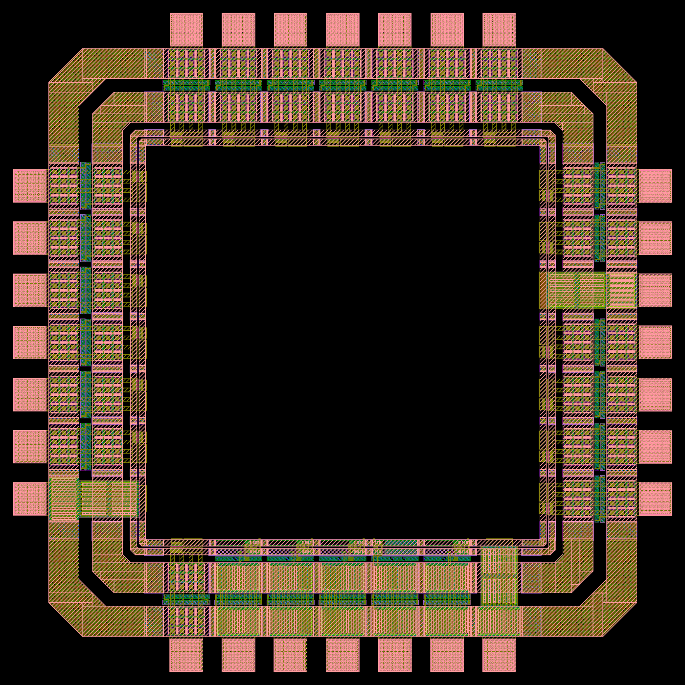
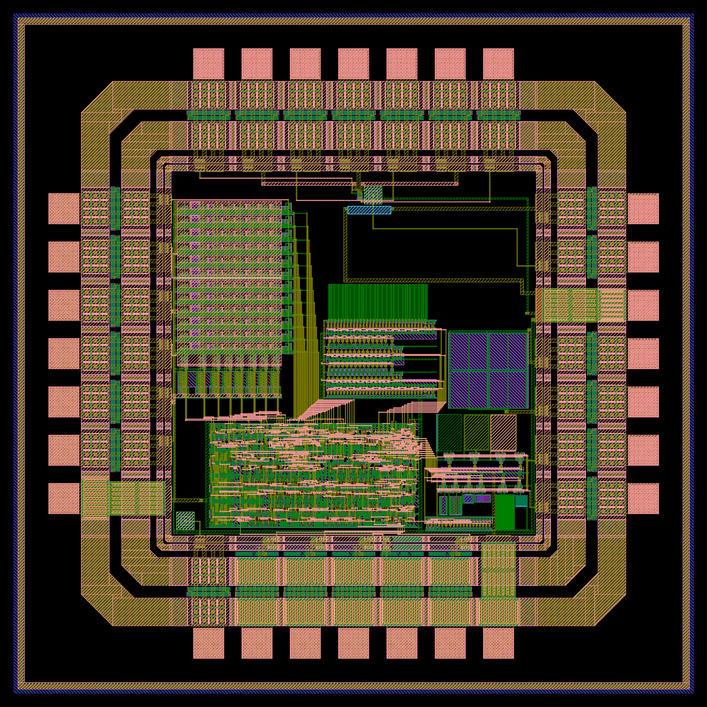
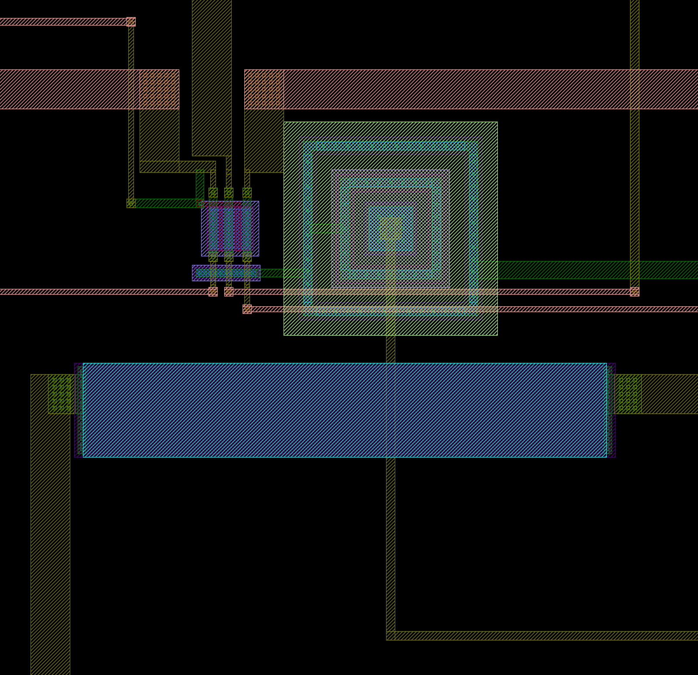

# 칩 조립 pdkv

PDK 모델 검증용 온칩 특성화 IC의 최상위 조립이다. 킷의 칩 조립 방식(FIR_PE MPW240925002, pong_pt1 MPW2025 STD-II)처럼 패드 링(`pdkv_Pad`)과 코어를 따로 만들어 최상위 `pdkv_Top`으로 합친다. 지금 칩은 패드 링 + 제어 블록 + 직결 기준 소자(L-split, MOS-C, PNP 2개, 히터)로 된 첫 제출 가능판이고, 어레이·CBCM·RO는 비워 둔 자리에 차례로 더한다.

```
pins.csv          28개 패드: 패드 위치(W1–W7 아래→위, N1–N7 왼→오, E1–E7 아래→위, S1–S7 왼→오), 핀, 셀, 포트, 기능, 범위
pad_ring.py       킷 28핀 GPIO 템플릿 → build/pdkv_Pad.mag, build/pad_pins.json(코어 쪽 포트 위치)
run_pad_ring.sh   패드 링 생성 → Magic GDS(lambda=0.30(ETRI-G)) → 공식 규칙 KLayout DRC, 킷 템플릿 링과 비교
assemble.py       블록 배치 + 배선 + 칩 경계·실링 → build/pdkv_Top.gds, build/pdkv_seal.gds, build/pdkv_nets.json(검사할 넷과 블록 위치)
chip_check.py     금속 연결 검사(끊김, 단락, 떠 있는 금속)와 0.01 µm 격자 검사
run_chip.sh       입력이 없으면 만들고(패드 링, 직결 소자, PDK 셀) 조립 → 공식 규칙 덱 → 문서 기준 금속·실링 규칙 → 연결 검사
```

## 패드 링



- 킷 템플릿 `pads_ETRI/MPW_PAD_28Pin_IO.mag`는 PIC 28개(PAD_0–PAD_27), 모서리 4개, 필러 32개를 1.9 × 1.9 mm 프레임에 135 µm 간격으로 놓는다. `pad_ring.py`는 템플릿 배치를 그대로 두고 셀만 바꾼다(PANA 20, PIC 4, POB4 1, PVDD 2, PVSS 1). 킷의 FIR_PE·pong_pt1도 같은 템플릿에서 셀을 바꿔 만들었다.
- 템플릿 순서는 쓰기 전에 변환 행렬로 확인한다: S1–S7 = PAD_0–PAD_6, E1–E7 = PAD_7–PAD_13, N1–N7 = PAD_20–PAD_14, W1–W7 = PAD_27–PAD_21. 패드 중심은 S변 545, 680, …, 1355 µm다.
- 코어 쪽 포트는 GPIO 셀 안쪽 끝(다이 좌표 442 µm와 1458 µm)의 금속2다. 코어 창은 1016 × 1016 µm다. 포트 위치는 `build/pad_pins.json`에 남긴다(PANA는 PAD 47.2 µm·PADR 27.2 µm 폭, PIC Y·POB4 A는 3.2 µm 폭).
- force·히터 6핀(ADF, ASF, LD1F, LSF, LD2F, HT)은 PANA의 무저항 포트 PAD에 잇는다. ETRI가 허용하지 않으면 `--force-port PADR`로 직렬 저항 포트로 바꾼다(문의 1번 답 대기).

### 결과 (2026-11-01, Codespace, 킷 db09a3d)

| 항목 | pdkv_Pad | 킷 템플릿 링(PIC 28개) |
|---|---|---|
| 셀 | 64개(PANA 20, PIC 4, POB4 1, PVDD 2, PVSS 1, 모서리 4, 필러 32), 못 찾은 셀 0 | 64개 |
| 크기 | 1705 × 1705 µm(97.5–1802.5 µm) | 같음 |
| 공식 규칙 KLayout DRC | 14개, 모두 5.NSD.S1 | 84개, 모두 5.NSD.S1 |

- 5.NSD.S1 표시는 ETRI GPIO 셀 안에서 나온다: GPIO 셀만 있는 템플릿 링에도 같은 규칙이 84개(PIC마다 3개) 있고, 디지털 입출력 셀이 5개(PIC 4·POB4 1)뿐인 우리 링은 14개다. 킷의 FIR_PE Calibre 결과에도 5.NSD.S1이 66개 있다.

## 칩 조립

```bash
bash designs/etri050/chip/run_chip.sh             # 결과 요약: build/chip_summary.txt
bash designs/etri050/chip/run_chip.sh --rebuild   # 패드 링·직결 소자·PDK 셀도 다시 만듦
```

킷 `generate_chip.sh` ④단계(각 GDS를 읽어 놓고 최상위로 씀)를 KLayout으로 한다. 패드 링은 자기 좌표(다이 좌표, 97.5–1802.5 µm) 그대로 두고, 나머지 블록은 GDS 셀째로 다이 좌표에 놓은 뒤 배선을 그린다. 모든 입력이 ETRI 층 번호의 GDS다.

| 블록 | GDS | 위치(다이 좌표 µm) | 연결 |
|---|---|---|---|
| 제어 블록 `teg_ctrl_F` | `ctrl/macro/teg_ctrl.gds.gz`(고정 매크로, 아래) | x 537.0–1140.9, y 460.0–761.1 | 스캔 5핀 → S2–S6, vdd 막대 ← W1 PVDD, gnd 막대 ← VSS, 위 변 `ro_in` 6개 → gnd(RO 뱅크를 넣을 때 푼다) |
| L-split | `direct/build/lsplit.gds` | 활성 영역 왼쪽 아래 (962.9, 1388.0) | force LD1F·LSF·LD2F → N2·N4·N6(PAD), sense → N3·N5·N7(PADR), LG → N1, 기판 탭 → VSS |
| MOS-C(위아래 뒤집음) | `direct/build/mosc.gds` | x 1214.8–1438.0, y 792.6–1013.7 | 게이트 막대(아래) → CHI(E3), N-well·p+ 막대(위) → CLO(E4) |
| PNP1 | `direct/build/pnp10.gds` | x 980.0–1029.0, y 1368.0–1417.0(L-split 바로 옆) | E → PE1(E6), B·C → VSS 가지, L-split 기판 탭과 짧은 금속1로 이어짐 |
| 히터(180° 회전) | `direct/build/heater.gds` | x 932.0–1056.0, y 1340.0–1361.6(L-split·PNP1 아래) | A(동쪽 머리) → HT(E7 PAD), B(서쪽 머리) → PVSS 전용 귀환선 |
| PNP2 | 같음 | x 455.0–504.0, y 458.0–507.0(남서 모서리) | E → PE2(S1), B·C → 남쪽 VSS 선 |





그림은 `klayout -b -r scripts/render_gds.py -rd gds=designs/etri050/chip/build/pdkv_Top.gds -rd png=<그림> -rd lyp=$ETRI050_LYP -rd width=1800`로 그린 것이다(확대 그림은 `-rd width=1600 -rd box=915,1290,1075,1445`).

열 묶음: 계획서의 M6(히터 + PNP + 기준 소자: 열저항, 자기 발열 보정)와 PE1 "기준 소자 옆"을 따른다. PNP1은 L-split 바로 옆에 두어 L-split 채널 중심과 PNP1 이미터 중심이 37 µm 떨어진다. 히터는 둘 아래에 가로로 두고, 히터 긴 변에서 L-split 채널과 PNP1 이미터까지가 똑같이 32 µm이고 두 소자 모두 히터 길이(124 µm)의 가운데 쪽에 있어, 히터 전력이 두 소자를 거의 같은 만큼 데운다(히터로 PNP1과 L-split의 열 결합을 맞춰 봄). L-split 고전류 바이어스(5 V × 4.6 mA ≈ 23 mW)가 PNP1 자리에 만드는 온도 상승은 점열원 근사 P/(2πκr)(κ = 150 W/m·K, r = 37 µm)로 약 0.7 K, V_EB로 약 1.4 mV(−2.1 mV/K)라 잴 수 있다. PNP2는 히터에서 약 1 mm 떨어진 남서 모서리에 있다.

빈 자리: 제어 블록 위(어레이, RO), 제어 블록 오른쪽(CBCM). 서쪽 패드(ANW, ADF, ADS, ASF, ASS, AG)와 E1·E2(VCD, VCR), S7 PVDD는 이 판에서 코어에 잇지 않는다.

### 배선 규칙

킷 덱이 아니라 공식 규칙 문서 v1.1의 값으로 그린다.

- 비아1·비아2는 0.8 × 0.8 µm, 서로 0.8 µm 이상(9.VIA1.S1·11.VIA2.S1 — 킷 덱은 0.5 µm로 옮김), 위아래 금속 0.6 µm 이상 덮음. 비아1을 접촉 위에, 비아2를 비아1 위에 쌓지 않는다(9.VIA1.S·11.VIA2.S). PNP 이미터(금속1 10 × 10 µm, 접촉 3 × 3)는 접촉 사이 네 자리에 비아1을 둔다(접촉까지 0.7 µm).
- 금속 폭 금속1 ≥ 0.8, 금속2 ≥ 1.0, 금속3 ≥ 1.2 µm, 다른 도형과 1.0 µm 이상. 전원·히터·force 선은 9 µm로, 10 µm부터인 넓은 금속 등급 아래에 둔다(넓은 금속은 간격 1.2 µm, 덱의 비아 덮음 검사가 좁은 부분에만 걸림). 금속 전류 밀도 한계는 ETRI 문의 4번 답을 기다리며, 1 mA/µm로 잡으면 9 µm는 9 mA다(L-split W 9/L 0.6 포화 4.6 mA, 소스 공유선은 둘이 함께 켜지면 약 7 mA, 히터 5 V에서 6.7 mA).
- 모든 좌표는 0.01 µm 격자 위다(규칙 문서 3.3, ETRI Calibre는 층마다 OFFGRID를 본다). 제어 블록 매크로도 격자에 맞춘 것이다(`ctrl/README.md`).
- PANA는 PAD·PADR 포트가 나란히 있으므로, 쓰는 포트에 곧게 들어가고 다른 포트와는 수 µm 이상 떨어진다.

### 전원

- VDD: W1 PVDD 포트 → 금속2 9 µm → 비아1 25개 → 금속1 → 제어 블록 vdd 막대(블록 왼쪽 끝 금속1 9 µm). S7 PVDD는 패드 링 전원 레일로 W1과 이미 이어져 있고, 코어에는 RO·CBCM을 넣을 때 잇는다.
- VSS: PVSS(E5) 포트에 세 갈래가 따로 붙어 패드에서만 만난다.
  1. 포트 아래쪽(y 1040–1049) → 비아1 25개 → 금속1 9 µm 선이 동쪽 가장자리(x 1447–1456)를 따라 내려가 남쪽 가장자리(y 446–455, 스캔 채널 아래)를 따라 서쪽 끝까지 간다. 제어 블록 gnd 막대 아래 끝과 PNP2 콜렉터 고리가 여기에 붙는다. 나중 블록(CBCM, 어레이)의 VSS도 이 선에서 받는다.
  2. 포트 가운데(y 1060–1066) → 금속1(x 1434–1438)로 동쪽을 따라 올라가 y 1381–1385로 PNP1 콜렉터 고리(동쪽 변) → 짧은 금속1로 L-split 기판 탭. 온도계와 기준 소자의 접지에 디지털 전류가 흐르지 않게 한다.
  3. 포트 위쪽(y 1114–1123) ← 히터 B(서쪽) 머리의 전용 귀환선(금속2 9 µm). 귀환선은 RO 자리(y 1142 아래)를 피해 y 1150–1159로 동쪽으로 간다.
- PNP의 베이스(N-well 고리)는 금속1 다리로 콜렉터 고리에 묶어 다이오드 연결로 쓴다(이미터만 패드로).
- 히터 전류(5 V에서 6.7 mA)는 PVSS 패드·본딩선에서만 코어 접지와 만난다. 그 저항(금선 지름 25 µm·길이 2 mm로 잡으면 약 0.1 Ω, 리드 포함 0.1–0.2 Ω)이 만드는 1 mV 안팎의 접지 이동은 PNP1·PNP2에 똑같이 걸리고, 전류를 바꿔 잰 V_EB 차이(2·3전류법)와 PNP1−PNP2 차이에서는 빠진다. V_EB 하나를 절대값으로 읽을 때는 히터를 끄고 잰다.

### 신호

- 스캔 채널(y 442–460): 제어 블록 아래 변 핀 5개에서 금속2로 내려와 금속3 트랙 4개(y 444.5 out·cck, 447.5 sle, 450.5 sdi, 453.5 sck)를 지나 남쪽 PIC Y·POB4 A 포트로 내려간다. 블록의 핀 순서(out, cck, sle, sdi, sck)와 패드 순서(SDI, SCK, SLE, OUT, CCK)가 달라도 트랙을 나눠 교차 없이 잇는다.
- L-split: force 세 줄은 셀 위로 나와 9 µm로 넓힌다(LSF는 N4로 곧게, LD1F는 왼쪽으로 꺾어 금속3 트랙 y 1420–1429로 N2, LD2F는 같은 높이 오른쪽으로 N6). LG는 poly 접촉 높이에서 왼쪽으로 빼 금속3 트랙(y 1440)으로 N1까지 간다. sense 세 줄은 셀 아래 끝에서 금속3(y 1378: LD1S 왼쪽, LSS 오른쪽 / y 1374: LD2S 오른쪽)으로 패드 x까지 간 뒤 금속2로 올라간다. 가로는 금속3, 세로는 금속2라 서로 다른 넷이 같은 층에서 만나지 않는다. sense는 소자의 접촉 줄 끝에서 갈라지므로(셀 안 Kelvin) 패드까지의 선 저항이 측정에 들어가지 않는다.
- MOS-C·PNP 이미터·히터 HT: 각 막대·머리를 셀 밖으로 늘인 금속1에 비아1 배열을 두고 금속2로 포트까지. HT는 히터 동쪽 머리에서 y 1350–1359로 E7 PAD까지, PE1은 PNP1 이미터에서 금속2로 히터 위를 지나 내려가 y 1298–1300으로 동쪽, E6 PADR까지 간다.
- 어레이 영역(x 452–872, y 763–1368) 위로 지나는 선은 y 1377 이상에만 있어 어레이 자리를 막지 않는다.

### 칩 경계·실링

- 칩 경계: 마이칩 MPW 표준칩은 1.9 × 1.9 mm이고(내 칩 제작서비스 소개 "MPW 표준칩 구성"), 킷 `generate_chip.sh`는 패드 링을 97.5 µm에 놓아 그 가운데에 둔다. 그래서 CHIPBOUNDARY(규칙 문서 2.1, 층 0)를 0–1900 µm 상자로 넣는다. 규칙 문서는 PWELL을 CHIPBOUNDARY에서 NWELL을 뺀 것으로 만든다(2.1 Layer Generation Rule).
- 실링: 규칙 문서 4.21 그림대로 칩 경계 안쪽 30 µm에 그린다(블록 `pdkv_SEAL`, `build/pdkv_seal.gds`). 그림은 층마다 마스크 명암으로 그려져 있어 표 2.1의 Digitized Area(금속·ACT는 어두운 부분, CONT·VIA·PSD는 밝은 부분이 그린 도형)로 읽는다. 그림 오른쪽 C/D 열은 스크라이브 레인의 명암이다. 링 안쪽(다이 쪽) 끝에서 잰 도형(굵은 숫자가 그린 구간):

| 층 | 그림의 구간(µm, 안쪽 → 스크라이브 쪽) | 그린 도형 |
|---|---|---|
| ACT, PSD | **30** | 링 전체(P+ 확산, LOCOS 없음, 아래는 PWELL) |
| CONT | 4.1 · **0.8** · 4.2 · **0.8** · 4.2 · **0.8** · 15.1 | 폭 0.8 µm 접촉 줄 3개 |
| MET1, MET2, MET3 | **18** · 12 | 안쪽 18 µm 금속(그림에는 금속 없는 12 µm만 적혀 있음) |
| VIA1 | 6.5 · **1.0** · 4.0 · **1.0** · 17.5 | 폭 1.0 µm 줄 2개 |
| VIA2 | 4.0 · **1.0** · 4.0 · **1.0** · 4.0 · **1.0** · 15.0 | 폭 1.0 µm 줄 3개 |

  NSD, POLY, NWELL은 그리지 않는다. 모서리는 설계 가이드 6.1의 PDK 실링 셀(SEALRING_UNIT, SEALRING_CONER) 그림처럼 직각이고, 줄마다 네 변을 맞닿은 상자 네 개로 그린다(구멍 있는 다각형 없음). 그림의 "Die to Seal ring: 30 µm"은 링 안쪽 30 µm 안에 다른 도형이 없는 것으로 검사한다(패드 링까지 67.5 µm).
- 킷 KLayout 덱은 CHIPBOUNDARY가 있으면 바깥 30 µm를 실링 구역으로 보고 일반 규칙에서 빼고, 21.SEAL 검사로 구역 안 CONT·VIA1·VIA2가 4.1·6.5·4.0 µm보다 좁은지, 금속이 12 µm보다 좁은지 본다. 그림 각 줄의 첫 숫자를 선폭으로 읽은 것이라 그림의 0.8·1.0 µm 줄이 걸린다(아래 결과의 21.SEAL 표시). 킷의 ETRI Calibre 요약(pong_pt1, 2025-06 PDK)에는 실링 규칙(21번대)이 없다.
- 제작된 선례(FIR_PE, pong_pt1)의 최상위 GDS에는 층 0과 실링이 없다. ETRI가 직접 넣는다고 하면 `PDKV_SEAL=0 bash run_chip.sh`(`assemble.py -rd seal=0`)로 둘 다 뺀다. 칩 경계 상자 하나와 블록 하나라 다른 블록·배선은 그대로다.

### 검사

1. 킷의 공식 규칙 변환 덱(KLayout)으로 칩 전체.
2. `scripts/metal_rules.py`: 규칙 7–12(접촉, 금속1–3, 비아1–2)를 문서 값으로(비아 간격 0.8 µm), 실링 구역은 덱처럼 빼고 4.21 그림과 도형이 같은지(층마다 XOR), 구역 안 다른 층과 링 안쪽 30 µm 안의 도형이 없는지 본다. 패드 링 단독에서도 나오는 표시는 따로 센다. 검사기 확인: VIA2 줄 끊기, 접촉 줄 넓히기, 링에 NSD 넣기, 링 안쪽 20 µm에 금속 넣기를 모두 잡는다.
3. `chip_check.py`: 금속1–3·비아1–2만으로 연결을 뽑는다(소자·저항이 단자를 잇지 않음).
   - 넷 17개(VDD, VSS, 스캔 5개, PE1·PE2, CHI, CLO, HT, LG, D1, S, D2, 실링)마다 패드 포트와 블록 핀의 점 50개가 한 넷에 있는지(끊김). 실링은 금속1–3이 비아 줄로 한 덩어리인지 본다.
   - 블록마다 따로 뽑은 금속 넷(패드 링 152, 실링 1, 제어 블록 662, L-split 5, MOS-C 2, PNP 3 × 2, 히터 2)의 한 점을 칩에서 찍어, 칩의 한 넷에 모인 블록 넷이 의도한 넷 하나가 모으려던 것과 정확히 같은지(넷 사이 단락, 블록 안 단락, 의도하지 않은 넷으로 새는 것).
   - 블록에 닿지 않은 배선 금속(떠 있는 조각), 0.01 µm 격자를 벗어난 좌표.
   - 검사기 자체 확인: 일부러 스캔 트랙 둘을 잇기, LG 비아2 지우기, 제어 블록 핀 둘을 잇기, 떠 있는 금속 넣기를 하면 각각 SHORT·OPEN·SHORT·FLOATING으로 잡힌다.
4. 블록 LVS는 블록 단계에서 한다(제어 블록 qflow·킷 Netgen, L-split·MOS-C etri-check). GPIO 셀, pnp10, 히터는 ETRI·PDK 레이아웃이라 킷 흐름처럼 핀만 본다.

### 결과 (2026-11-01, Codespace, 킷 db09a3d, 82 s)

| 항목 | 결과 |
|---|---|
| `pdkv_Top.gds` | 1900 × 1900 µm(칩 경계 0–1900 µm, 패드 링 97.5–1802.5 µm로 FIR_PE·pong 최상위와 같은 자리), 블록 8개(실링 포함) |
| 공식 규칙 KLayout DRC | 46개: 5.NSD.S1 14개는 패드 링 단독 결과와 위치까지 같다(GPIO 셀 안). 21.SEAL.W_CONT 12·W_VIA2 12·W_VIA1 8개는 실링의 접촉·비아 줄(3·3·2줄 × 4변)로, 덱이 4.21 그림의 간격을 선폭으로 읽어 생긴 표시다(위 칩 경계·실링 절) |
| 규칙 7–12·실링 4.21, 문서 값 | 16개, 모두 11.VIA2.S1 — 패드 링 단독에도 같은 자리에 있다(ETRI GPIO 셀 안 비아2 간격 0.65 µm, 킷 덱의 0.5 µm는 넘음. 킷 pong_pt1의 ETRI Calibre 요약에도 11.VIA2.S1 8개). 실링은 그림과 층마다 같고, 배선·블록에서 새로 생긴 것 0 |
| 금속 연결 | 넷 17개(점 50개) 모두 한 넷, 단락 0, 떠 있는 금속 0 |
| 0.01 µm 격자 | 벗어난 좌표 0 |

실링을 넣기 전(PR #11, 77 s)에는 칩 범위가 패드 링과 같은 97.5–1802.5 µm, 공식 규칙 표시는 5.NSD.S1 14개, 연결 검사는 넷 16개(점 47개)였다.

## 다음 단계

ETRI 답(force 포트, 본딩도, 리포트 형식, 전류 밀도)을 반영하고, 비워 둔 자리에 Kelvin 어레이(NMOS) → CBCM·RO → PMOS 행·FO4를 더한다. 단계마다 `run_chip.sh`로 칩 전체 검사를 다시 통과시킨다.
