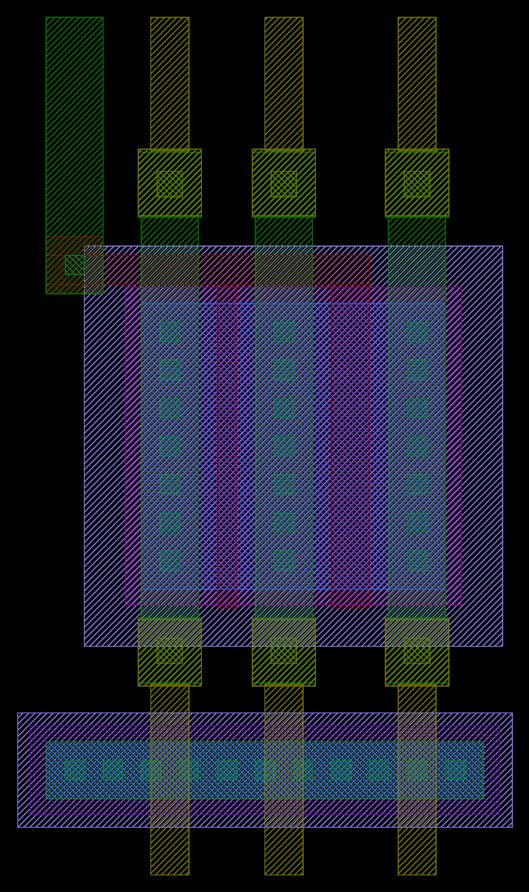
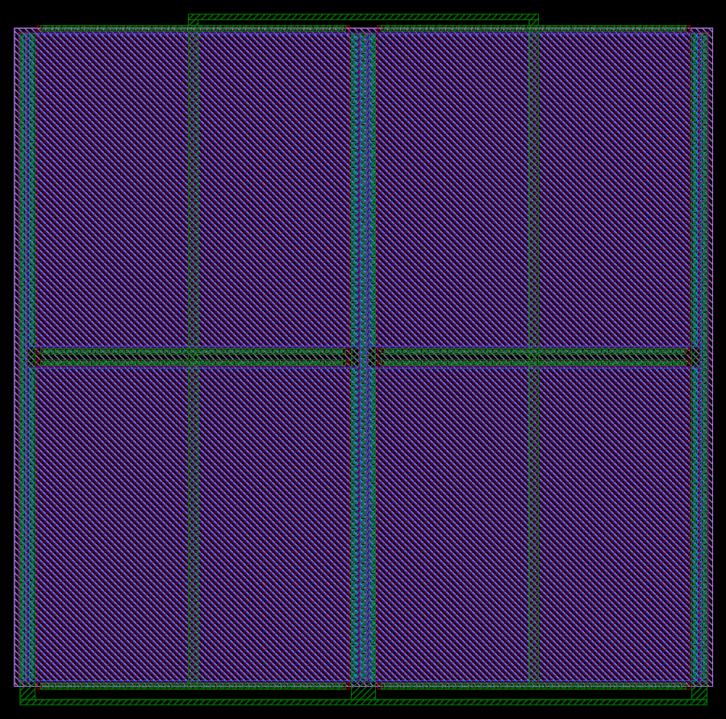

# 직결 기준 소자

어레이·스위치를 거치지 않고 패드에 바로 잇는 기준 소자다. 생성기는 `designs/etri050/gen/etri050_direct.py`이고, `etri050_mos.py`처럼 Python이 λ 격자(0.3 µm, 반 λ 허용)에서 좌표를 정하면 Magic이 킷 기술로 그린다. 셀마다 LVS용 회로도 넷리스트를 같이 쓴다.

```bash
python3 designs/etri050/gen/etri050_direct.py            # lsplit, mosc → designs/etri050/direct/build
python3 designs/etri050/gen/etri050_direct.py --check    # Magic DRC, ETRI GDS, 공식 규칙 KLayout DRC, LVS (etri-check)
```

| 셀 | 내용 | 크기 | 포트 |
|---|---|---|---|
| `lsplit` | NMOS W 9 µm, L 0.6·1.2 µm(어레이 열 0·1과 같은 기하), 게이트·소스 공유 | 13.8 × 27.0 µm | LG, LD1F, LSF, LD2F, VSS |
| `mosc` | N-well MOS 커패시터: P채널 게이트 99.9 × 99.9 µm 4개(2 × 2, 합 39,920 µm², 약 118 pF), 양옆 p+ 줄이 반전층 공급, 조각 사이 n+ 웰 탭 | 223.2 × 221.1 µm | CHI(게이트), CLO(N-well + p+) |

 

- `lsplit`: 드레인 두 개와 공유 소스의 접촉 줄마다 위쪽 끝은 force(비아1 → 금속2), 아래쪽 끝은 sense(비아1 → 금속2)로 나눈다(접촉 줄에서 갈라지는 Kelvin). 게이트는 활성 영역 위 poly 막대로 묶어 왼쪽 접촉에서 금속1로 낸다. 기판 탭은 sense 비아 아래에 두고 금속2가 그 위를 지난다. sense 줄은 force와 같은 넷이라 셀 포트로는 내지 않는다(한 넷의 두 포트는 LVS가 구분하지 못함). 칩 조립 때 sense 패드(LD1S, LSS, LD2S)로 잇는다.
- `mosc`: 게이트 한 점에서 가장 가까운 n+ 탭까지 약 54 µm로, 탭 거리 규칙(≤ 60 µm) 안이다. 게이트 접촉 줄은 조각마다 위아래에 있고 열마다 금속1 띠로 묶어 위쪽 막대(CHI)로, p+ 줄과 탭은 아래쪽 막대(CLO)로 모은다. Magic 추출은 소스·드레인이 같은 넷이라 "device missing 1 terminal; connecting remainder to node CLO" 경고를 4번 내며, 결과 넷리스트(pfet D = S = B = CLO, G = CHI, W = L = 99.9 µm)는 의도와 같다.
- 99.9 µm는 λ 격자(333λ)에 맞춘 값이다(100 µm는 격자 밖).

## 결과 (2026-11-01, Codespace, 킷 db09a3d)

| 셀 | Magic DRC | 공식 규칙 KLayout DRC | LVS |
|---|---|---|---|
| lsplit | 0 | 0 | MATCH (nfet 9/0.6, 9/1.2, 속성 일치) |
| mosc | 0 | 0 | MATCH (pfet 99.9/99.9 × 4, 속성 일치) |

## PNP 온도계와 히터 (다음 단계)

Magic 추출은 BJT·poly2 저항을 소자로 만들지 못하고, 킷의 Magic ETRI 출력 스타일은 BJT(56)·RES(51)·LVSD(60) 표시층을 만들지 않는다. 그래서 이 둘은 PDK GDS 셀을 칩 GDS 단계에서 합친다(패드 링과 같은 ETRI-G 경로).

- PNP: 킷 `analog_ETRI/GDS/NSPL_0p5um.gds`의 `pnp10`(49 × 49 µm, NWELL·ACT·NSD·PSD·MET1과 BJT 표시층 56, ntap·ptap 하위 셀)을 그대로 두 개 쓴다. 베이스·콜렉터는 VSS, 이미터는 PE1·PE2.
- 히터: 같은 파일의 `p2res`는 104 × 3.6 µm 예시라 크기가 다르다. 같은 층 구성(POLY2 13, RES 51, LVSD 60, poly2cont 하위 셀)으로 W 20 × L 120 µm를 만들고 공식 규칙(POLY2 저항 폭 ≥ 2.0 µm, 길이 ≥ 4.0 µm, 저항 위 CONT 간격 0.6 µm, RES 안 POLY1·ACT·NSD/PSD 금지)으로 검사한다.
- 칩 LVS에서 두 소자는 GPIO처럼 핀만 있는 블랙박스로 다룬다.
