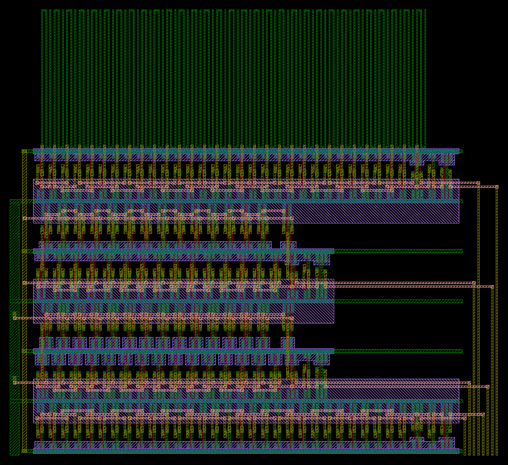
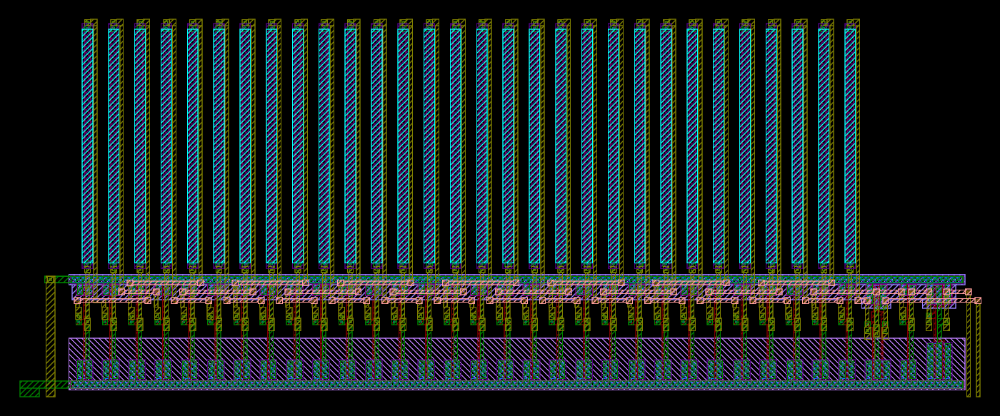

# RO 뱅크 robank, 저항 RO rores

계획서 "4. RO 뱅크(공정·온도 모니터)"의 블록이다. INV·NAND·NOR·배선 RO는 블록 `robank`, 저항 RO는 자리가 달라 블록 `rores`(아래 절)다. 31단 링 발진기 여러 종류의 주파수 비로 서로 다른 공정 정보를 얻는다(계획서: NAND/NOR 비는 SF·FS에, INV는 SS·FF에 반응). 생성기는 `designs/etri050/gen/etri050_ro.py`이고, CBCM 블록처럼 Python이 λ 격자(0.3 µm)에서 좌표를 정하고 킷 표준셀(INVX1, INVX4, NAND2X1, NOR2X1)을 놓으면 Magic이 그린다. 회로도 넷리스트는 회로 정의에서 따로 만들어 LVS로 맞춘다.

```bash
python3 designs/etri050/gen/etri050_ro.py            # 두 블록: build/robank.mag, robank_flat.gds, sch/robank.spice, robank_pins.json,
                                                     #   rores.mag, p2r40.mag, rores_flat.gds, rores_full.gds(저항 포함), sch/rores.spice, rores_pins.json
python3 designs/etri050/gen/etri050_ro.py --check    # 평탄화한 Magic DRC, etri-check(LVS); rores는 저항 기하 검사와
                                                     #   저항까지 넣은 GDS의 소자 수준 LVS(rores_lvs.py)도
python3 designs/etri050/gen/etri050_ro.py --block rores   # 한 블록만(robank, rores, all)
python3 designs/etri050/ro/rores_lvs.py              # 소자 수준 LVS만(build/rores_full.gds, 일치하면 0으로 끝남)
cd designs/etri050/sim/blocks && python3 run_all.py ro_post    # 계획 부하·그린 배선으로 주파수
```

칩에 들어가는 것은 Magic이 평탄화한 사본으로 쓴 `robank_flat.gds`다(계층 그대로 쓰면 셀 레일의 탭 접촉이 따로 만들어져 겹친다, CBCM과 같음).

## 회로

모든 RO는 31단이고 0단이 NAND2X1(A = 30단 출력, B = ro_en<i>)이다: 멈춘 RO가 정해진 상태에 있고 켜면 기본 모드로 돈다(계획서 모의: 그냥 켜면 NAND RO가 3배 고조파로 돌 수 있음). 0단 출력에 탭 INVX1 → INVX4를 달아 제어 블록 ro_in<i>를 구동하고, 제어 블록이 rosel로 하나를 골라 ÷256으로 OUT에 낸다.

| 번호(제어 블록) | 종류 | 1–30단 | 계획서와 다른 점 |
|---|---|---|---|
| 0 | INV | INVX1 | 탭 |
| 1 | NAND | NAND2X1, B = VDD | 탭 |
| 2 | NOR | NOR2X1, B = VSS | 탭 |
| 3 | FO4 | — | 넣지 않음(아래) |
| 4 | 배선 | INVX1, 0–30단 출력마다 금속1 사행선(폭 0.9 µm, 99.6 µm 다리 세 개, 약 307 µm)이 필드 위에 | 탭. 계획 300 µm × 0.8 µm에 해당 |
| 5 | 저항 | INVX1, 1–30단 출력마다 poly2 저항 W 2 × L 80 µm(40 sq) 뒤에 다음 단 | 블록 `rores`(아래). 탭 |

robank에 없는 둘: 블록 자리(제어 블록 위, 어레이 행 버스 오른쪽, 히터 귀환선 아래: 다이 x 856–1210, y 823–1146 µm)에 배선 RO의 금속(31 × 307 µm)까지 넣으면 셀 여섯 줄과 사행선으로 찬다.

- FO4는 셀이 3800λ(네 줄)라 남는 어느 자리에도 들어가지 않는다. 계획서가 면적이 모자라면 먼저 빼라고 정한 RO다(게이트 용량은 CBCM 셀 8·9가 직접 잼). 제어 블록의 ro_en3은 연결하지 않고(출력), ro_in3은 VSS에 묶어 둔다.
- 저항 RO(단 1–30 뒤 poly2 W 2 × L 80 µm = 40 sq, 규칙 14.PL2PR.W ≥ 2 µm)는 이 블록에 들어가지 않는다. 칩 GDS에서 잰 히터 귀환선 위 빈 띠(다이 x 932–1405, y 1160–1297: 아래 귀환선 금속2, 위 PE1 금속2, 서쪽 귀환선 세로, 동쪽 PE1 세로)에 셀 한 줄과 그 위 저항 30개로 따로 넣었다(블록 `rores`, 아래). 계획서의 우선순위가 "RO 5종(INV, NAND, NOR, 배선, 저항)"이고 선택은 FO4뿐이다.

## 레이아웃



그림은 `klayout -b -r scripts/render_gds.py -rd gds=designs/etri050/ro/build/robank_flat.gds -rd png=<그림> -rd lyp=$ETRI050_LYP -rd width=1400`로 그린 것이다.

- 크기 351.75 × 321.0 µm(그린 λ 좌표, 채널 끝과 VDD 기둥 끝 포함; GDS는 비아 패드 가장자리를 0.05 µm 당겨 351.7), 칩에서 원점이 다이 (856.0, 826.0)이고 GDS 범위는 다이 x 857.2–1208.9, y 823.0–1144.0. 셀 132개(RO마다 31단 + 탭 2), 표준셀 줄 6개(120λ), 홀수 줄은 뒤집어 이웃 줄과 레일을 나눈다(gnd y 0·240·480·720λ, vdd 120·360·600λ). vdd 레일마다 위아래 줄의 셀을 덮는 N-well 하나.
- INV·배선 RO는 한 줄에 서쪽부터 S15 S16 S14 S17 … S1 S30 S0, 탭 순으로 엇갈려 놓아 모든 연결이 셀 두 개 안이다. NAND·NOR RO는 두 줄로 접는다: 아래 줄 S15…S0·탭, 위 줄 S16…S30. 위 줄을 10λ 동쪽에서 시작하고 S30을 S0보다 10λ 서쪽에 두어, 꺾임(S15 → S16)과 닫힘(S30 → S0)이 나눠 쓰는 gnd 레일을 금속2 직선으로 건넌다.
- 연결은 셀 위 금속3 트랙(9λ 간격, 줄마다 5개)과 핀까지 금속2 꽂이(비아 패드가 핀에서 4λ 이상). NAND·NOR의 B를 VDD·VSS에 묶는 것도 줄마다 트랙 하나로 모아 서쪽 기둥에 잇는다: 킷 셀의 레일은 전체가 탭 접촉이라 레일 위 비아1은 규칙 문서(비아1을 접촉 위에 두지 않음)에 걸린다(첫 판에서 문서 규칙 검사가 60개를 잡음).
- 0단·탭이 동쪽 끝에 있어 ro_en·ro_in이 짧게 동쪽 채널(금속2 8줄, 11λ 간격)로 가고 채널이 블록 아래 변으로 나간다.
- 배선 RO 사행선: 단마다 출력 핀에서 금속2로 맨 윗줄 gnd 레일 위까지 올라와 비아1, 금속1 다리 셋(10λ 간격, 서로 2.1 µm, 다음 단 사행선과도 2.1 µm). 다리 끝(블록 y 318.0, 다이 1144.0)은 히터 귀환선 금속2(y 1150)보다 6 µm 아래다.

## 검사 결과

| 항목 | 결과 |
|---|---|
| Magic DRC(평탄화한 사본) | 0(계층 그대로는 킷 셀 레일 맞닿음 7) |
| LVS(etri-check, Netgen) | MATCH |
| 공식 규칙 KLayout DRC, `robank_flat.gds` | 0(KLayout 0.28.16, 킷 111dc09 덱. 같은 덱이 일부러 넣은 금속1 0.5 µm 간격을 8.MET1.S1로 잡는 것을 확인). etri-check가 보는 계층 GDS(`robank.gds`)로는 7.CONT.S1 300개: 맞닿은 셀 레일의 탭 접촉이 셀마다 따로 만들어져 0.3 µm 간격으로 놓인 자리라, 칩에는 평탄화한 사본을 쓴다 |
| 규칙 7–12, 문서 값(`scripts/metal_rules.py`) | 0 |
| 안테나(블록 단독) | 넘는 넷 0. 가장 큰 비 poly 14, 금속1 182(배선 RO 사행선, 확산 있음), 금속2 70, 금속3 44 |

## 모의 (`sim/blocks/ro_post.py`)

TT 27 °C, 5 V, MHz. "블록"은 그린 블록의 넷리스트에 계획서 모의(`ro_bank.py`)와 같은 부하(마디마다 5 fF, 배선 RO는 + 43.5 fF)를 단 것으로, 계획 값과 탭 하나만 다르다. "그린 배선"은 그 부하 대신 GDS에서 뽑은 마디마다의 배선 용량(금속·필드 poly, 규칙 문서 용량표; 접합·게이트는 소자 모델)을 단 것이다.

| RO | 계획(ro_bank) | 블록 | 그린 배선 | SS/TT | FF/TT | SF/TT | FS/TT | 125 °C | 전력 mW |
|---|---|---|---|---|---|---|---|---|---|
| INV | 123.1 | 121.8 | 99.2 | 0.921 | 1.082 | 0.990 | 1.005 | 81.0 | 5.7 |
| NAND | 93.8 | 93.1 | 83.2 | 0.925 | 1.076 | 1.011 | 0.983 | 66.8 | 6.8 |
| NOR | 66.8 | 66.4 | 60.6 | 0.929 | 1.071 | 0.972 | 1.023 | 49.2 | 6.0 |
| 배선 | 65.0 | 64.6 | 55.9 | 0.911 | 1.095 | 0.995 | 1.002 | 45.8 | 5.4 |

- 마디마다 배선 용량은 INV·NAND·NOR 13–25 fF(셀 안 출력 금속1·다음 단 입력의 필드 poly·핀·꽂이·트랙), 배선 RO 61–72 fF(사행선 약 45 fF 포함). 계획서가 가정한 5 fF보다 커서 그린 블록은 9–19 % 느리다. 칩 측정은 이 "그린 배선" 값과 비교한다.
- NAND/NOR 비 TT: 계획 1.404, 그린 배선 1.373. 코너 비(SS·FF·SF·FS)는 계획서 표와 같은 모양이다.
- 이 표의 모의는 ngspice-42로 돌렸다. 계획 값을 낸 `ro_bank.py`를 같은 환경에서 다시 돌리면 INV 123.1, NAND 93.8, NOR 66.8, FO4 52.8, 배선 65.0, 저항 69.1 MHz로 Codespace(ngspice-47) 기록과 같아, 두 판의 차이가 값에 들어가지 않는다.
- 규칙 문서 표에는 같은 층 이웃 사이 용량이 없어, 배선 RO 사행선 다리 사이(2.1 µm)의 결합은 넣지 않았다(이웃 다리가 다른 단이면 서로 다른 때에 전환). CBCM 빗살(셀 5)이 0.9 µm 간격 옆면 용량을 재므로 그 값으로 이 몫을 어림할 수 있다.
- 탭 출력(ro_in) 배선은 블록 안 12–30 fF이고 칩 배선(통로 금속3·2)이 더해진다. INVX4가 구동하고 RO 마디가 아니라 주파수에 들어가지 않는다.

## 칩 연결 (`../chip/assemble.py`)

| 넷 | 연결 |
|---|---|
| ro_en0·1·2·4, ro_in0·1·2·4 | 블록 동쪽 채널(다이 x 1184–1209)에서 아래로, 제어 블록 위 통로(y 786–814, 4 µm 간격 금속3 트랙 8개; CBCM 위 변 780.6)로 서쪽, 금속2로 제어 블록 위 변 핀(y 761)까지 |
| VDD | 제어 블록 vdd 막대(x 537–546)를 위로 늘이고, 금속1 9 µm 선(y 763–772)으로 어레이 채널의 금속2 꽂이 아래를 지나 블록 서쪽 VDD 기둥(x 857.2–863.8)으로 |
| VSS | 제어 블록 gnd 막대(x 1131.6–1140.6)를 위로 늘여 블록 맨 아래 gnd 레일(y 824.8–827.2)에 붙임 |
| ro_in3 | 제어 블록 gnd 막대 위 금속1 띠(y 765–767)에 비아1로 묶음(FO4, 만들지 않음). ro_in5는 저항 RO로(아래) |

## 저항 RO rores



그림은 `klayout -b -r scripts/render_gds.py -rd gds=designs/etri050/ro/build/rores_full.gds -rd png=<그림> -rd lyp=$ETRI050_LYP -rd width=1400`로 그린 것이다.

### 회로와 레이아웃

- 회로는 계획서 모의(`sim/blocks/ro_bank.py`의 res)와 같다: 0단 NAND2X1(A = r5_30, B = en5, 출력 r5_0), 1–30단 INVX1이 m5_s를 내고 저항 R5_s가 그것을 다음 단 입력 r5_s로 잇는다. 탭 INVX1 → INVX4가 r5_0에서 in5를 낸다.
- 저항은 킷 PDK 셀 `p2res`(`analog_ETRI/GDS/NSPL_0p5um.gds`, W 2 × L 100 µm)의 층과 치수를 L만 80 µm로 바꾼 것이다: POLY2 2.0 × 82.4 µm, LVSD(두 접촉 사이, L) 2.0 × 80.0 µm → 40 sq, 끝마다 0.6 µm 접촉 하나를 LVSD 경계에 붙이고(규칙 14.PL2PR.S2 = 0) POLY2 끝에서 0.6 µm·옆에서 0.7 µm 안쪽(14.PL2PR.E2 ≥ 0.5), 금속1 머리 1.8 µm, RES는 POLY2 밖 0.8 µm. 폭 2 µm에 접촉 하나는 규칙 문서 4.14 (c)의 Pcell 표와 같다. 히터와 같은 층 구성이다(`../direct/pdk_cells.py`).
- 주입: 규칙 문서 표 2.4(소자 층 표)는 "Poly2 Res." 열에 NSD를 1로 적었지만, 4.14의 14.PL2PR.bad4(RES 안 NSD·PSD 금지), 킷 KLayout·Calibre 덱(같은 이름의 규칙), PDK `p2res` 셀은 모두 주입이 없다. Calibre 덱 이력에는 2023-11-15에 N형 poly 저항 규칙(14.PL2NR.*)을 모두 지웠다고 적혀 있다. 셀과 덱을 따라 주입 없이 그렸고(공식 덱 0), 표 2.4와 다른 점은 ETRI에 물을 거리로 남긴다.
- 한 줄을 뒤집어 놓고(vdd 레일 y 0, gnd 레일 y 120λ) INV RO처럼 S15 S16 S14 … S1 S30 S0, 탭 순으로 엇갈린다. 저항은 단마다 그 셀 위(셀 x + 15λ)에, gnd 레일 위 4λ에서 시작해 N-well 밖 필드 위에 선다. 단 출력 핀에서 금속2가 곧게 올라와 아래 머리에 비아1(m5_s), 위 머리에서 비아1·금속2 막대·금속2 귀환선이 그 셀의 동쪽 부분(x + 22–26λ, INVX1 핀은 x + 18.5λ까지)으로 내려와 줄 위 금속3 트랙(94·104·114λ)에서 다음 단 A 핀 꽂이로 간다(r5_s). 귀환선이 저항 뒤 마디에 붙으므로 배선 용량이 계획서 모의처럼 저항 뒤에 있다(값은 계획서보다 크다, 아래 모의).
- 트랙 간격은 10λ다: 귀환선의 비아2와 다음 셀 A 꽂이의 비아2가 x로 9.5λ라, 9λ 간격 트랙에 서로 다른 넷으로 놓이면 비아 패드가 대각선으로 3.5λ보다 가깝다(첫 판에서 생성기의 간격 검사가 30곳을 잡음). 같은 넷인 S15 → S16(이웃 셀)은 비아2 두 개 대신 금속2 꺾임 하나로 잇는다: 두 비아 패드 사이 2.5λ 틈을 채운 첫 판은 GDS에서 비아 패드가 0.05 µm 작아져 0.05 µm 띠가 남아 공식 덱이 12.MET3.W로 잡았다.
- Magic은 저항의 두 머리를 블랙박스 셀 `p2r40`(금속1 패드, 포트 A 아래·B 위, LEFview 속성)으로 그린다. LVS(Netgen)는 이것을 두 핀 부분 회로로 비교하므로 고리의 순서까지 맞춰 본다(작은 넷리스트로 확인: 두 저항의 끝을 바꾸거나 한 저항을 뒤집으면 불일치). KLayout이 평탄화한 GDS에 저항 층(POLY2, CONT, LVSD, RES, 금속1 머리)을 넣어 `rores_full.gds`를 만든다. Netgen은 이 저항 층을 보지 못하므로 `--check`는 `rores_full.gds`를 KLayout으로 소자 수준까지 다시 뽑아 비교한다(`rores_lvs.py`, 아래 검사 결과). Magic 기술 파일의 rpoly2는 ETRI GDS 양식에서 표시 층 없이 POLY2로만 나가고 그 표시 층(pseudo_rpoly2)까지 POLY2로 써서 저항 폭이 바뀌므로 쓰지 않았다.
- 크기 328.95 × 129.3 µm(그린 λ 좌표), 칩에서 원점이 다이 (932.0, 1166.0)이고 GDS 범위는 다이 x 933.2–1262.1, y 1161.8–1291.15.

### 검사 결과

| 항목 | 결과 |
|---|---|
| Magic DRC(평탄화한 사본) | 0(계층 그대로는 킷 셀 레일 맞닿음 2) |
| LVS(etri-check, Netgen) | MATCH(저항은 블랙박스 `p2r40`) |
| 소자 수준 LVS(`rores_lvs.py`, KLayout, `rores_full.gds`) | MATCH: NMOS 35, PMOS 35, 저항 30개(몸체 POLY2∧LVSD∧RES = Calibre 덱의 PPRES, 125 Ω/sq × 80/2 → 각 5000 Ω, 머리는 몸체 밖 POLY2가 CONT로 금속1에)가 생성기의 회로(킷 표준 셀 트랜지스터 넷리스트 + R 5000 Ω)와 같다. 검사기 확인: 기준에서 저항 하나를 4 kΩ으로, 두 저항의 끝을 맞바꾸기, 탭을 1단 출력으로 옮기기, 레이아웃에서 저항 하나의 RES 지우기, 위 머리 접촉 지우기, 금속1로 두 머리 잇기, LVSD를 60 µm(30 sq)로 줄이기 7가지가 모두 불일치 |
| 공식 규칙 KLayout DRC, `rores_full.gds`(저항 포함) | 0 |
| 규칙 7–12, 문서 값 | 0 |
| 저항 기하(`check_resistors`, `rores_full.gds`) | 30개 모두 POLY2 2.0 × 82.4 µm 한 덩어리, LVSD 부분 2.0 × 80.0 µm(40 sq), RES가 다 덮음, 접촉은 저항마다 둘이고 각각 제 머리(A·B) 금속1 안. 그 밖의 POLY2·POLY2 위 접촉 없음 |
| 안테나(블록 단독) | 넘는 넷 0. 가장 큰 비 poly 14, 금속1 18, 금속2 81(귀환선, 금속2 단계에서 확산 없음), 금속3 19 |

### 모의 (`sim/blocks/ro_post.py`)

TT 27 °C, 5 V, MHz. "블록"은 계획서 모의의 부하(저항 뒤 마디마다 5 fF, 저항은 p2res 40 sq만)에 탭을 단 것이다. "그린 배선"은 마디마다 GDS에서 뽑은 배선 용량(POLY2·RES·LVSD를 뺀 GDS로: 저항의 두 머리가 두 넷으로 남음)과, 그린 저항 그대로의 모델(p2res RSH 125 Ω/sq × 40 sq와 PDK TC1·TC2, 끝마다 POLY2 접촉 50 Ω(규칙 문서 5.3 typ), 몸체 용량을 10토막으로 나눔)을 쓴 것이다.

| RO | 계획(ro_bank) | 블록 | 그린 배선 | SS/TT | FF/TT | SF/TT | FS/TT | 125 °C | 전력 mW |
|---|---|---|---|---|---|---|---|---|---|
| 저항 | 69.1 | 68.6 | 34.2 | 0.960 | 1.035 | 0.994 | 1.001 | 29.5 | 3.4 |

- 그린 저항 RO는 계획 값의 절반이다. 저항 뒤 마디의 배선이 19.6–22.4 fF(귀환선 금속2 약 116 µm가 11 fF, 다음 단 입력의 필드 poly 4.5 fF, 트랙·꽂이·머리)로 계획서의 5 fF보다 크고, 몸체 용량이 더해져 RC 몫이 커졌다. 저항 앞 마디(m5_s)는 7.8–8.2 fF다.
- 몸체 용량: 규칙 문서 5.5 표에 POLY2–필드 값이 없어 POLY1의 "Poly to field"(0.0902 fF/µm², 0.0519 fF/µm)를 썼다(저항 하나 23.6 fF). POLY2는 POLY1보다 높이 놓이므로 상한으로 본다. 85 %로 잡으면 35.4 MHz, 몸체 용량을 빼면 44.4 MHz다.
- RSH 110 / 140 Ω/sq(규칙 문서 5.2 min / max): 36.2 / 32.4 MHz(+5.9 / −5.3 %). 계획서 부하(블록 열)로는 72.6 / 65.1 MHz(+5.8 / −5.2 %)라, 그린 배선이 RSH에 대한 감도를 줄이지 않았다. MOS 모서리에는 그린 쪽이 조금 더 민감하다(SS / FF: 그린 −4.0 / +3.5 %, 계획서 부하 −2.6 / +1.7 %). RES/INV 비(그린 배선, TT 대비): SS +4.2 %, FF −4.4 %, SF +0.4 %, FS −0.4 %(계획서 모의 +5.2 / −5.4 / −0.1 / −0.1 %).
- 칩 측정의 기대값은 그린 배선 값(34.2 MHz, 몸체 용량을 모르는 만큼 34–44 MHz)이고 계획서 값(69.1 MHz)이 아니다. 저항 뒤 배선을 줄이지 않고 그대로 둔 근거: 이 RO가 재려는 RSH에 대한 감도가 계획서와 같고(위), 귀환선은 위 머리를 셀 줄로 되돌리는 선이라 이 배치(셀 한 줄 위에 선 저항)에서는 없앨 수 없다.
- 측정에서는 같은 POLY2인 히터(W 20 × L 120 µm)로 RSH와 온도계수를 직접 재고, INV RO로 MOS 쪽을 잡는다. 그러면 저항 RO 주파수는 남은 몫, 곧 저항 뒤 용량(문서에 값이 없는 POLY2–필드 용량 포함)과 p2res 모델의 RC 지연을 검증한다.
- 저항 RO는 히터를 끄고 잰다: 저항(POLY2 위 끝 y 1288.9)이 히터 아래 변(y 1340) 51 µm 아래에 있고, 30개 중 서쪽 12개가 히터와 x(955–1056)로 겹친다. 히터를 켜면 저항(p2res TC1 3.9 × 10⁻⁴ /K)과 셀이 데워져 주파수가 바뀐다.

### 칩 연결 (`../chip/assemble.py`)

| 넷 | 연결 |
|---|---|
| en5·in5 | 블록 동쪽 채널 선(금속2, 다이 x 1260.5–1261.7·1257.2–1258.4) 아래 끝(y 1161.8)에 비아2, 금속3으로 히터 귀환선(금속2 y 1150–1159)을 건너 내려와 en5 y 1096·in5 y 1100에서 서쪽, RO 뱅크(금속3 x 1208.9까지)와 MOS-C(금속3 없음) 사이 틈(in5 x 1210.0–1211.2, en5 x 1212.25–1213.45)을 내려가 제어 블록 위 통로 트랙(en5 y 818, in5 y 822)으로 서쪽, 금속2로 ro_en[5]·ro_in[5] 핀(y 761)까지 |
| VDD | RO 뱅크 VDD 기둥(금속1 x 857.2–863.8)을 y 1164.8까지 늘이고 금속1 선(y 1158.2–1164.8)으로 동쪽, 히터 귀환선 세로 부분(금속2 x 922–931) 아래를 지나 블록 VDD 기둥(x 933.2–939.8)으로 |
| VSS | RO 뱅크 VSS 기둥(금속2 x 866.2–869.2)을 y 1172까지 늘여 비아2, 금속3 선(y 1168–1172)으로 귀환선 세로 부분 위를 건너 블록 VSS 기둥(금속2 x 942.2–945.2)에 비아2. 히터 귀환선(PVSS 전용)에는 닿지 않음 |
